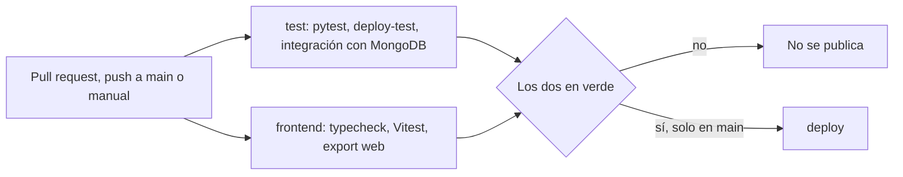
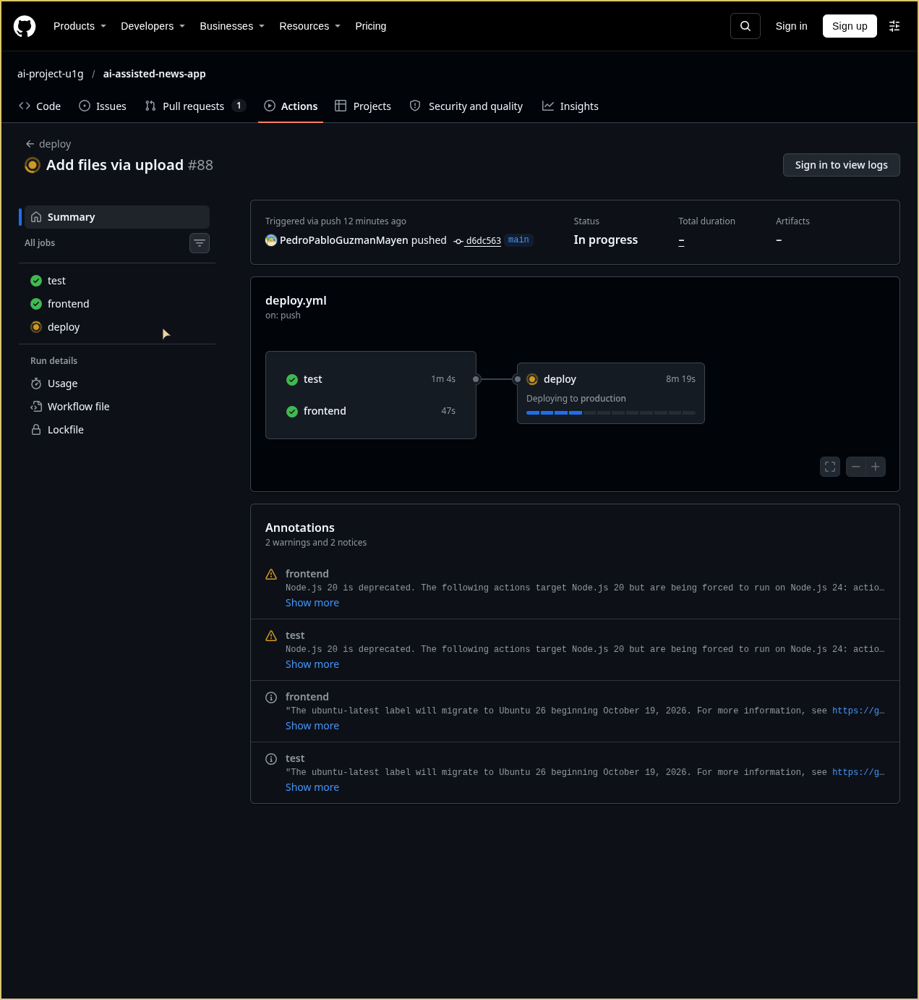

# 1 Integración continua CI
Herramienta y motivo de elección: GitHub Actions. El código ya vive en GitHub, así que el flujo corre sin servidor propio ni costo adicional. Además queda versionado junto al código en el archivo `.github/workflows/deploy.yml` y se conecta con el entorno `production` del despliegue.

Implementación: El flujo se activa en cada pull request, en cada push a `main` y de forma manual con `workflow_dispatch`. Corre dos jobs en paralelo.

1. El job `test` usa Python 3.13 con caché de pip, instala las dependencias de desarrollo del backend, ejecuta pytest sobre los servicios assistant y news, valida el contrato de los scripts de despliegue sin nube ni secretos y corre las pruebas de integración de feed, perfil y chat contra una base MongoDB efímera.
2. El job `frontend` usa Node 24 con caché de npm, ejecuta `npm ci`, la revisión de tipos con TypeScript, las pruebas con Vitest y el export web sin publicar.

El job de despliegue depende de ambos, así que si uno falla no se publica nada. Un grupo de concurrencia encola las ejecuciones sobre la misma rama para que no se pisen.

Estado y resultado: Implementado y funcionando. En la última verificación sobre `main`, commit `6b1c02a`, pasaron 430 pruebas de backend, con 1 omitida, y 81 pruebas de frontend. En GitHub, la ejecución 43552233962 terminó con `test` y `frontend` en verde, en 64 y 47 segundos. El CI también ha cumplido su función de filtro: 2 pull requests de Dependabot fueron rechazados por el job `frontend` antes de llegar a `main`, según la [línea base de CD](../02-cd/evidencias/linea-base-2026-11-13.md).

Responsable y fecha: Gustavo Adolfo Cruz Bardales, 13 de noviembre de 2026.

Evidencia:

1. Archivo de configuración: [`.github/workflows/deploy.yml`](../../../../.github/workflows/deploy.yml).
2. Resumen de los jobs `test` y `frontend` con el commit analizado: [resumen-workflow-deploy.md](evidencias/resumen-workflow-deploy.md).
3. Pipeline en GitHub: https://github.com/ai-project-u1g/ai-assisted-news-app/actions/workflows/deploy.yml
4. Captura de la pestaña Actions con los jobs `test` y `frontend` en verde:

   
