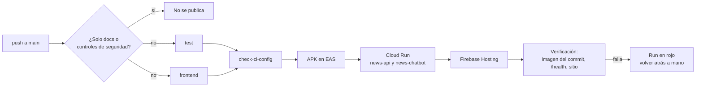
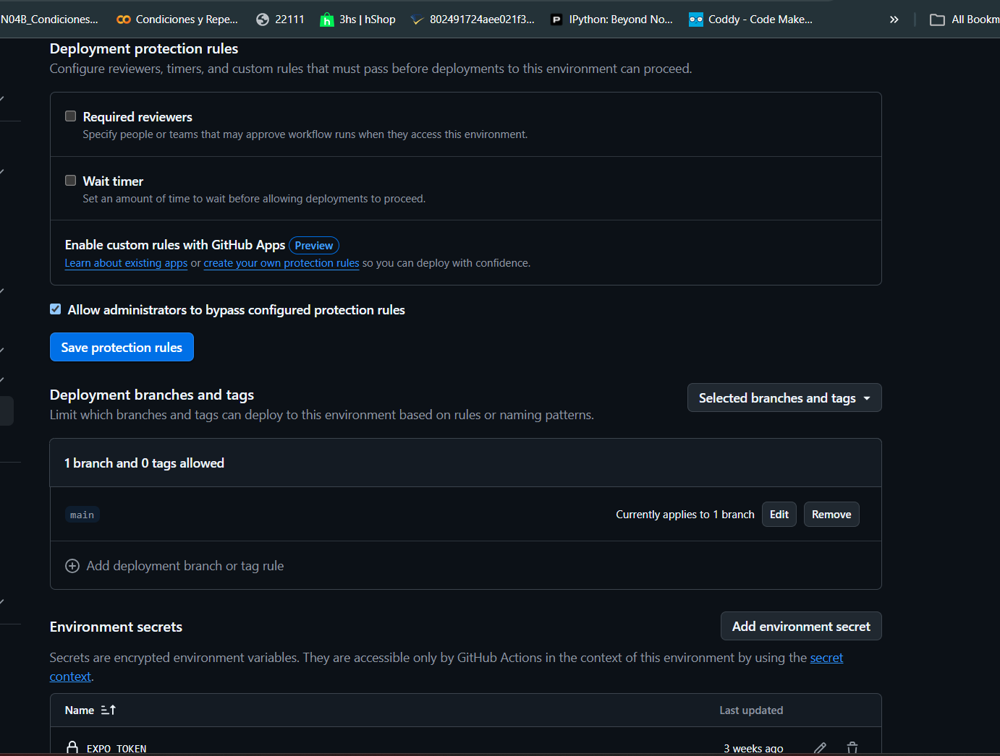
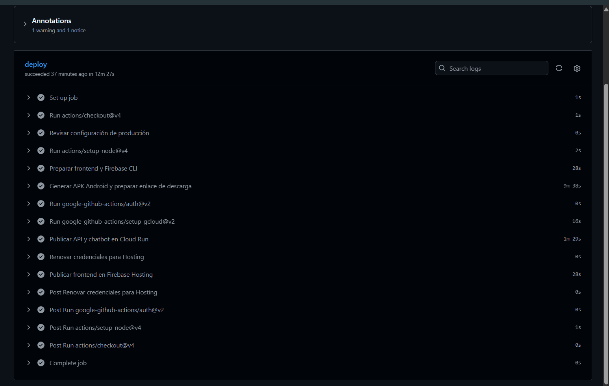
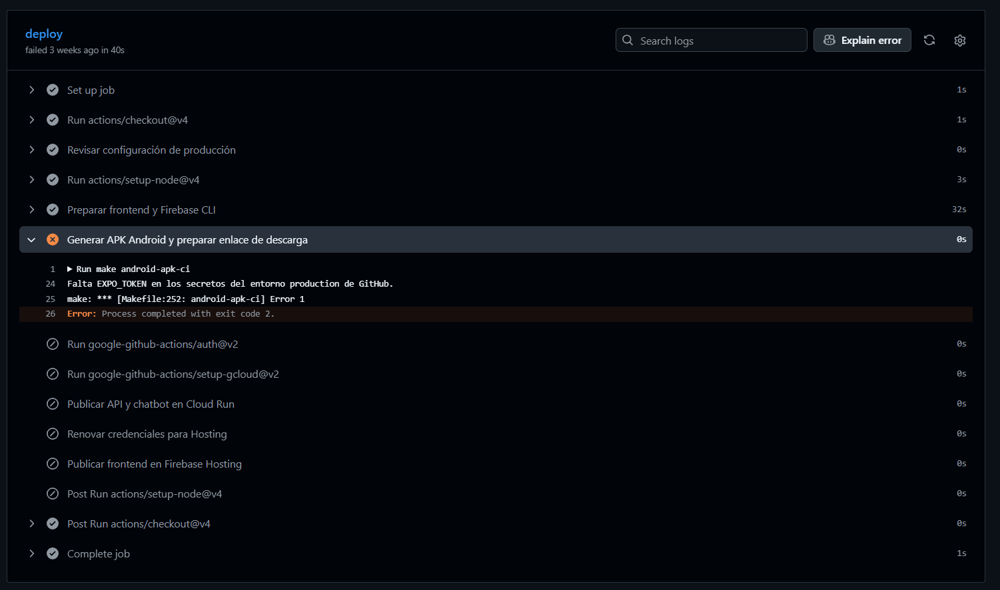
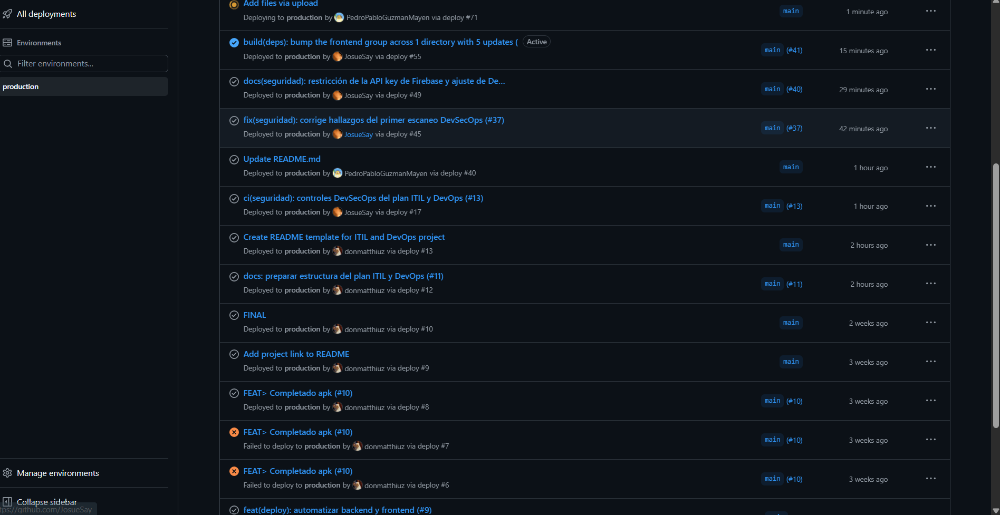
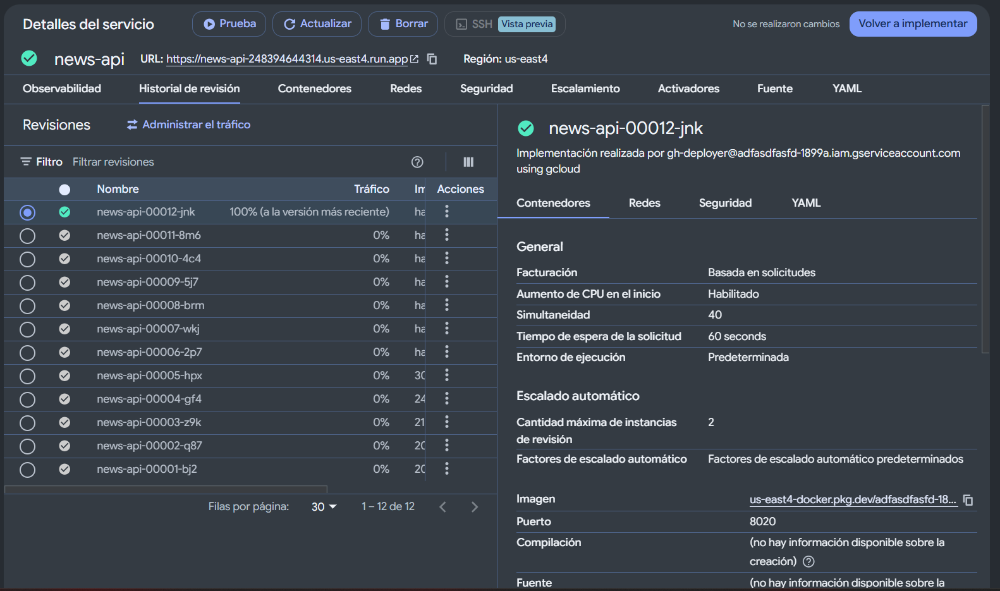
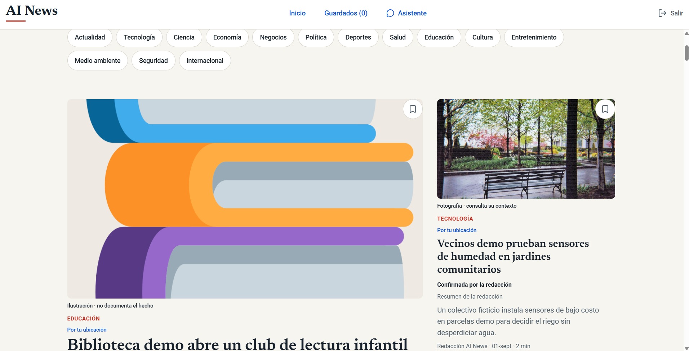

# 2 Despliegue continuo CD

**Estado:** Implementado desde el 20 de octubre de 2026. Las mejoras de este apartado (filtro de
rutas y verificación posterior al despliegue) entran con el PR de `ci/cd-mejoras`; las brechas
restantes tienen propuesta de mejora (ver al final).

## Plataforma y motivo de elección

| Componente | Plataforma | Motivo |
| --- | --- | --- |
| Orquestación | GitHub Actions (`.github/workflows/deploy.yml`) | Está en el mismo repositorio que el código, es gratuito en repositorios públicos y ya corre las pruebas de CI |
| `news-api` y `news-chatbot` | Cloud Run, `us-east4` | Contenedores sin servidores que administrar, escala a cero cuando no hay uso y conserva cada revisión para volver atrás |
| Frontend web | Firebase Hosting | El mismo proyecto de Firebase Authentication, con CDN y HTTPS incluidos |
| APK Android | EAS Build (Expo) | Firma y compila Android sin mantener un entorno de build propio |
| Credenciales | Workload Identity Federation | El runner obtiene credenciales de corta duración; no hay llaves JSON en GitHub |

## Implementación

**Cómo se activa:** un push a `main` (merge de un PR o cambio directo) o **Actions → deploy → Run
workflow**. En un PR solo corren las pruebas; nunca se publica.

**Entorno:** `production` en GitHub, que solo acepta la rama `main`. Google Cloud repite la
restricción: la condición de WIF solo admite este repositorio y `refs/heads/main`.

**Validaciones antes de publicar:**

1. `test`: pytest de backend, contrato de los scripts de despliegue (`make deploy-test`) e
   integración de feed, perfil y chat con MongoDB efímera.
2. `frontend`: typecheck, tests y export web.
3. `check-ci-config.sh`: que existan todas las variables de `production` antes de tocar la nube.
4. El APK debe terminar en EAS; si no, no se publica nada.

### Mejoras de este apartado

| Mejora | Dónde | Qué resuelve |
| --- | --- | --- |
| Filtro de rutas | `paths-ignore` en `deploy.yml` | Un push que solo cambia `docs/`, archivos `.md` de la raíz, `backend/loops/` o archivos de los controles de seguridad ya no genera APK, revisiones de Cloud Run ni releases de Hosting. Basta un archivo fuera de la lista para desplegar |
| Verificación posterior | `deploy/smoke-test.sh`, último paso del job `deploy` | Comprueba que los dos servicios sirven la imagen de este commit, que `/health` responde `ok` (incluye la conexión a MongoDB) y que el sitio responde. Deja una tabla en el resumen del run. Es de solo lectura |
| Verificación manual | `make deploy-smoke TAG=<sha>` | La misma revisión desde una terminal con `gcloud`, sin desplegar |
| Procedimiento para volver atrás | [`pipeline-paso-a-paso.md`](../../pipeline-paso-a-paso.md#volver-a-una-versión-anterior) | Revertir el commit por PR, o mover el tráfico de Cloud Run y revertir Hosting desde la consola |

## Decisión

- **Controles livianos, sin reglas que bloqueen al equipo.** Mientras se completa el plan, varios
  integrantes suben documentación directo a `main`. Proteger `main` o pedir aprobación en
  `production` los bloquearía. El filtro de rutas resuelve el problema práctico (despliegues
  innecesarios) sin cambiar cómo trabaja nadie. La protección de `main` queda en la propuesta, igual
  que en el apartado 6.
- **Lista de exclusión y no de inclusión.** Si alguien agrega una carpeta nueva que sí llega a
  producción, se despliega por defecto. El error posible es publicar de más, nunca dejar de publicar.
  `backend/assistant/prompts/*.md` no se excluye porque el chatbot lo lee en ejecución.
- **Verificar después de publicar en lugar de antes.** Lo que más falla es la conexión con
  servicios reales (MongoDB Atlas, IAM, variables de `production`), y eso solo se ve en producción.
  Hoy no hay staging; la verificación al menos avisa en el mismo run, en lugar de esperar a que un
  usuario lo note.
- **Volver atrás a mano.** Un rollback automático tendría que coordinar dos servicios, Hosting y el
  APK. Revertir el commit por PR deja los tres componentes alineados y pasa por las mismas pruebas.

## Estado y resultado

Mediciones del 13 de noviembre de 2026. La línea base está en
[`evidencias/linea-base-2026-11-13.md`](evidencias/linea-base-2026-11-13.md).

| Indicador | Antes | Después |
| --- | --- | --- |
| Pushes a `main` que dispararon el despliegue sin cambiar la app | 16 de 24: 6 publicaron todo, 1 falló, 8 se cancelaron en espera y 1 seguía en curso | 0. Simulado: la lista de `paths-ignore` aplicada al historial descarta esos 16 y deja los 8 con cambios de código o configuración |
| Verificación después de publicar | Ninguna | Revisión nueva lista y con el tráfico, imagen del commit, `/health` y sitio. Probada contra producción con `make deploy-smoke TAG=bf7c60b`: detectó que el chatbot no tomó la versión nueva (ver hallazgos) |
| Procedimiento para volver atrás | No documentado | Documentado, con comandos |
| Tests de los scripts de despliegue | 9 | 10 (`make deploy-test`), incluido un caso por cada falla que detecta la verificación |
| Lead time de `main` a producción | 13 a 14 min, cerca del 70 % en el APK | Sin cambio; ver propuesta 2 |
| Tasa de éxito del pipeline | 82 % (9 de 11) | Se mide después del merge |

**Versión desplegada al cierre (13 nov, 21:40):** mixta. `news-api` está en `bf7c60b`
(revisión `news-api-00013-cpb`); `news-chatbot` (`news-chatbot-00014-s8w`) y Hosting siguen en
`2eeab8a`, del run 55. Sitio: <https://adfasdfasfd-1899a.web.app>.

### Hallazgos durante la medición

| Hallazgo | Evidencia | Tratamiento |
| --- | --- | --- |
| Varios pushes seguidos cancelan los despliegues en espera | Runs 73, 74, 76, 83, 84 y 87 cancelados sin iniciar ningún job. GitHub guarda una sola ejecución en espera por grupo de `concurrency` | Es el comportamiento esperado: siempre se publica el último commit. Se corrigió la descripción en la línea base |
| Un despliegue quedó a medias | El run 71 publicó `news-api`, pero la revisión nueva del chatbot (`news-chatbot-00015-hdc`) terminó con `exit(3)` porque no pudo conectarse a MongoDB al iniciar. El run falló y no publicó Hosting | Cloud Run no manda tráfico a una revisión que no arranca y dejó al chatbot en la anterior. Eso protege a cada servicio, pero no a los tres en conjunto: producción quedó con dos versiones. La verificación nueva lo detecta, y el procedimiento para volver atrás ya está documentado |
| La primera versión de la verificación daba un falso `OK` | Comparaba la imagen de la plantilla del servicio, que es la del último intento aunque no haya arrancado | Ahora exige que la revisión nueva esté lista y reciba el 100 % del tráfico. El test cubre ese caso |
| Despliegues sin cambios en la app | 16 de 24 pushes a `main` | Filtro de rutas |

**Responsable y fecha:** Pedro Pablo Guzmán Mayen · 13 de noviembre de 2026.

## Relación con ITIL

| Práctica de ITIL | Aplicación concreta |
| --- | --- |
| Gestión de despliegues | Un único camino a producción (`main` → `deploy.yml`), con credenciales temporales y verificación al final |
| Gestión de liberaciones | El APK, los dos servicios y la web salen del mismo commit; la imagen lleva el SHA como etiqueta y la verificación comprueba que es la publicada |
| Habilitación de cambios | Cada cambio pasa por pruebas antes de publicarse. Los cambios sin efecto en producción ya no ocupan una ventana de despliegue |
| Monitoreo y gestión de eventos | La verificación posterior convierte una falla en producción en un run en rojo y un aviso al equipo |
| Mejora continua | La línea base midió frecuencia, lead time, tasa de éxito y tiempo de recuperación; se vuelven a medir después del merge |

Seguimiento: quien hace merge a `main` revisa que el run termine en verde y que la tabla de
verificación muestre `OK`. Si no, sigue el procedimiento para volver atrás.

## Evidencia

### Línea base

- [Línea base](evidencias/linea-base-2026-11-13.md): historial de los 47 runs, configuración de
  GitHub y Google Cloud, indicadores y hallazgos.

*Figura 1. Entorno `production`: solo `main`, sin revisores y con `EXPO_TOKEN` como único secreto.*

*Figura 2. Run 40: el job `deploy` tarda 12m 27s, de los que 9m 38s son el APK.*

*Figura 3. Run 6: el pipeline se detiene antes de tocar la nube porque falta `EXPO_TOKEN`.*

*Figura 4. Despliegues a `production`, incluidos los dos fallos del 21 de octubre.*

*Figura 5. Cloud Run conserva las revisiones anteriores de `news-api`, publicadas por `gh-deployer`.*

*Figura 6. Sitio publicado en Firebase Hosting.*

