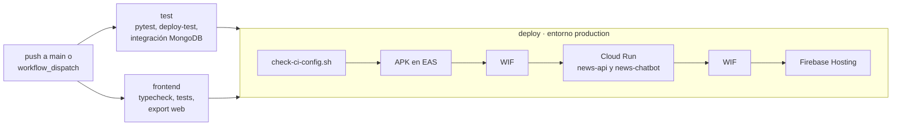

# Línea base del despliegue continuo (13 de noviembre de 2026)

Estado del pipeline de despliegue antes de aplicar mejoras de CD. Sirve como punto de comparación
para medir el efecto de los cambios que se propongan en este apartado.

## Alcance y método

- Commit analizado: `1b328e5` (`main`). Workflow: `.github/workflows/deploy.yml`.
- Historial: las 47 ejecuciones del workflow `deploy` desde su creación (20 de octubre de 2026).
- Todas las consultas fueron de solo lectura. No se lanzó ningún despliegue ni se cambió
  configuración en GitHub ni en Google Cloud.
- Ningún comando leyó `keys/` ni archivos `.env`. Este documento solo nombra variables y secretos;
  no reproduce sus valores.
- Horas en hora de Guatemala (UTC−6).

| Fuente | Herramienta | Qué se obtuvo |
| --- | --- | --- |
| API pública de GitHub | `curl` | Ejecuciones, jobs, pasos y duraciones; entorno `production`; deployments; protección de `main` |
| Google Cloud | `gcloud run`, `gcloud iam`, `gcloud artifacts` | Revisiones de Cloud Run, imagen desplegada, condición de WIF, roles del pipeline, imágenes guardadas |
| Firebase Hosting | API REST `releases` | Historial de publicaciones del sitio y quién las hizo |
| Servicios publicados | `curl` | Respuesta HTTP del sitio y de `/health` de los dos backends |

## Plataformas

| Componente | Plataforma | Cómo se publica |
| --- | --- | --- |
| `news-api` (FastAPI) | Cloud Run, `us-east4` | `deploy/gcp/deploy.sh`: build, push a Artifact Registry y `gcloud run deploy` |
| `news-chatbot` (assistant en modo news) | Cloud Run, `us-east4` | Mismo script, imagen `--target runtime` |
| Frontend web (Expo export) | Firebase Hosting | `deploy/firebase/ci.sh` → `deploy/firebase/hosting.sh` |
| APK Android | EAS Build (Expo) | `make android-apk-ci` → `deploy/expo/build-ci.sh`; el enlace se inyecta en la web |

Imágenes en `us-east4-docker.pkg.dev/<proyecto>/ai-news/`, etiquetadas con el SHA corto del commit.

## Flujo del pipeline

- En un PR solo corren `test` y `frontend`. El job `deploy` exige `refs/heads/main` y un evento
  distinto de `pull_request`.
- `concurrency: deploy-${{ github.ref }}` con `cancel-in-progress: false`: dos pushes seguidos a
  `main` se encolan, no se cancelan ni se pisan.
- Si falla cualquier paso, los siguientes no corren. No hay rollback automático.

## Configuración de GitHub y Google Cloud

| Control | Estado |
| --- | --- |
| Entorno `production` | Creado el 20 de octubre de 2026 |
| Regla de despliegue del entorno | Solo la rama `main` (`custom_branch_policies`) |
| Revisores obligatorios del entorno | Ninguno: el despliegue no espera aprobación |
| Bypass de administradores | Permitido (`can_admins_bypass: true`) |
| Protección de `main` | No configurada: se puede hacer push directo sin PR ni checks |
| Variables del entorno | `GCP_PROJECT_ID`, `GCP_REGION`, `WIF_PROVIDER`, `DEPLOYER_SA`, `CHATBOT_PROVIDER`, `OPENAI_MODEL`, `NEWS_CHAT_INPUT_USD_PER_MILLION`, `NEWS_CHAT_OUTPUT_USD_PER_MILLION`, `EXPO_PUBLIC_FIREBASE_*` (4). Son parámetros públicos |
| Secretos en GitHub | Solo `EXPO_TOKEN`, inyectado únicamente en el paso del APK |
| Autenticación con Google Cloud | Workload Identity Federation, sin llaves JSON. Condición verificada: `assertion.repository=='ai-project-u1g/ai-assisted-news-app' && assertion.ref=='refs/heads/main'` |
| Roles de `gh-deployer` en el proyecto | `run.developer`, `firebasehosting.admin`, `serviceusage.apiKeysViewer`, `serviceusage.serviceUsageConsumer`. A nivel de recurso: `artifactregistry.writer`, `compute.networkUser` e `iam.serviceAccountUser` sobre las cuentas de los servicios (`deploy/gcp/bootstrap.sh`) |
| Secretos de ejecución | MongoDB y OpenAI en Secret Manager, montados como archivos. El pipeline no los lee ni los cambia |
| Cambios de IAM y esquema DB | El pipeline no los hace (`ALLOW_PUBLIC` solo se usa en el primer deploy manual) |

## Historial de despliegues en `main`

| Run | Fecha | Evento | Commit | Resultado | Duración total | Paso más lento |
| :---: | --- | --- | --- | --- | ---: | --- |
| 2 | 20 oct 10:35 | push | `f05254a` | Éxito sin publicar: faltaban `WIF_PROVIDER` y `DEPLOYER_SA` y la versión de entonces omitía el deploy | 0:27 | — |
| 4 | 20 oct 21:24 | push | `1a0e026` | Éxito: primera publicación automática de Cloud Run y Hosting | 3:43 | Cloud Run 1:19 |
| 6 | 21 oct 00:09 | push | `a65996d` | Falla en «Generar APK» a los 0 s (exit code 2) | 1:44 | — |
| 7 | 21 oct 00:16 | manual | `a65996d` | Falla igual que el run 6 | 2:00 | — |
| 8 | 21 oct 00:20 | manual | `a65996d` | Éxito | 12:57 | APK 9:18 |
| 9 | 24 oct 15:38 | push | `9629e3e` | Éxito | 13:53 | APK 9:50 |
| 10 | 30 oct 23:40 | push | `7fe4914` | Éxito | 13:13 | APK 9:31 |
| 12 | 13 nov 18:50 | push | `3fc9f51` | Éxito | 17:24 | APK 12:30 |
| 13 | 13 nov 18:53 | push | `871bb90` | Éxito, tras esperar en cola al run 12 | 28:59 | APK 9:52 |
| 17 | 13 nov 20:12 | push | `523ab6a` | Éxito | 13:43 | APK 9:03 |
| 40 | 13 nov 20:28 | push | `9a4a575` | Éxito | 13:47 | APK 9:38 |
| 45 | 13 nov 20:38 | push | `1b328e5` | Éxito, tras esperar en cola al run 40 | 16:10 | APK 8:57 |

Antes de la automatización, un integrante publicó Hosting a mano dos veces el 20 de octubre (20:30
y 20:45). Desde el run 4, todas las publicaciones del sitio las hace la cuenta `gh-deployer`.

Los runs 6 y 7 fallaron en el mismo commit y el run 8 pasó sin cambios de código. El paso falló
antes de llamar a EAS, que es el comportamiento de `deploy/expo/build-ci.sh` cuando falta
`EXPO_TOKEN`. La causa más probable es que el secreto se agregó al entorno entre el run 7 y el 8;
los logs completos requieren permisos de escritura en el repositorio.

## Indicadores

| Indicador | Valor | Cálculo |
| --- | --- | --- |
| Frecuencia de despliegue | 9 publicaciones en 25 días; 5 de ellas el 13 de noviembre | Runs de `main` con publicación exitosa |
| Tasa de éxito del pipeline | 82 % (9 de 11) | Runs de `main` con configuración lista (se excluye el run 2) |
| Lead time de `main` a producción | 13 a 14 min sin cola; hasta 29 min con cola | Creación del run → fin del job `deploy` (sin cola: runs 8, 9, 10, 17, 40) |
| Peso del APK en el lead time | Cerca del 70 % | El build en EAS tarda de 9 a 12,5 min; Cloud Run, 1:15 a 1:30; Hosting, 20 a 30 s |
| Tiempo de recuperación | 24 min | Fallo del run 6 (00:09) → fin del run 8 (00:33) |
| Fallos detectados antes de `main` | 2 PR de Dependabot rechazados por `frontend` (Expo 58 y el grupo de frontend) | Ejecuciones de PR con resultado `failure` |

## Versión desplegada y verificación

| Servicio | URL | Revisión activa | Imagen | Verificación |
| --- | --- | --- | --- | --- |
| `news-api` | `https://news-api-gfr6cqd5yq-uk.a.run.app` | `news-api-00010-4c4` | `news-api:1b328e5` | `/health` → HTTP 200 |
| `news-chatbot` | `https://news-chatbot-gfr6cqd5yq-uk.a.run.app` | `news-chatbot-00012-xg2` | `news-chatbot:1b328e5` | `/health` → HTTP 200 |
| Frontend web | `https://adfasdfasfd-1899a.web.app` | Release del 13 nov 20:54 (37 archivos) | Export del run 45 | Raíz → HTTP 200, HTML |

La etiqueta de la imagen es el commit, así que cada revisión de Cloud Run se puede rastrear hasta
su código. Cloud Run conserva las revisiones anteriores y Firebase Hosting conserva el historial de
releases; ambos permiten volver a una versión previa a mano.

## Hallazgos

### Cualquier push a `main` llega a producción sin revisión

`main` no tiene protección y el entorno `production` no exige aprobación. Un push directo despliega
igual que un PR revisado. Ocurrió el 13 de noviembre: `871bb90` y `9a4a575` se editaron en la web de
GitHub directo sobre `main` y cada uno publicó los tres componentes.

### Cambios sin efecto en la app disparan el despliegue completo

El workflow no filtra por rutas. De los 5 despliegues del 13 de noviembre, 3 solo cambiaron
documentación (`3fc9f51`, `871bb90`, `9a4a575`) y 1 solo agregó un workflow de seguridad
(`523ab6a`). Cada uno generó un APK en EAS (unos 10 min y un build de la cuota de Expo), dos
revisiones de Cloud Run, dos imágenes y un release de Hosting idénticos en función.

### No hay verificación después de publicar

El pipeline termina al publicar Hosting. Los dos backends exponen `/health`, pero el workflow no los
consulta, ni revisa el sitio. Un servicio que arranque y luego falle no detiene el pipeline ni
avisa al equipo.

### Despliegue secuencial sin rollback

El orden es APK → `news-api` → `news-chatbot` → Hosting. Si falla un paso intermedio, los anteriores
quedan publicados y el resto no. Por ejemplo, la API nueva puede quedar con el chatbot o la web
anteriores. Volver atrás es manual: `gcloud run services update-traffic --to-revisions` en Cloud Run
y el historial de releases en la consola de Hosting. No hay un procedimiento documentado.

### Un solo entorno

No existe staging ni vista previa por PR. La primera vez que un cambio corre en Cloud Run y Hosting
reales es en producción. Las pruebas de PR usan MongoDB efímera y CLIs simuladas
(`make deploy-test`); no validan IAM, variables del entorno ni los servicios reales.

### Imágenes acumuladas sin política de limpieza

Artifact Registry `ai-news` no tiene `cleanupPolicies`. Guarda 19 versiones de cada imagen y ocupa
683 MB, por encima de los 0,5 GB sin costo del servicio. Crece en promedio unos 35 MB por
despliegue. Se revisa
también en `07-finops/`.

### Acciones con versiones antiguas

`actions/checkout@v4`, `actions/setup-node@v4`, `google-github-actions/auth@v2` y `setup-gcloud@v2`
generan avisos de Node.js 20 obsoleto. Dependabot ya abrió los PR de actualización (`auth@v3`,
`setup-gcloud@v3`, `checkout@v7`, `setup-node@v7`, `setup-python@v7`), que pasan CI pero no se han
integrado. Las acciones se referencian por etiqueta mayor y no por SHA.

## Lo que ya funciona

- Producción solo se publica desde `main`, y lo garantizan dos controles independientes: la regla
  del entorno en GitHub y la condición de WIF en Google Cloud.
- Sin llaves de cuenta de servicio: el runner obtiene credenciales de corta duración por WIF y las
  renueva antes de Hosting.
- `check-ci-config.sh` valida la configuración antes de tocar la nube.
- Las pruebas de backend, frontend y scripts deben pasar antes de cualquier publicación.
- Los despliegues de `main` se encolan sin cancelarse (runs 12/13 y 40/45).
- El sitio, el APK y los backends salen del mismo commit: Hosting resuelve las URLs de Cloud Run
  recién desplegadas y el enlace del APK recién construido.

## Evidencias gráficas pendientes

Capturas a agregar en esta carpeta, con secretos y valores ocultos:

| Archivo sugerido | Qué mostrar |
| --- | --- |
| `github-cd-antes-entorno-production.png` | Settings → Environments → `production`: regla de rama y ausencia de revisores |
| `github-cd-antes-run-exitoso.png` | Actions → deploy → run 40: los tres jobs y los pasos del job `deploy` con duraciones |
| `github-cd-antes-run-fallido.png` | Actions → deploy → run 6: falla en «Generar APK» |
| `github-cd-antes-deployments.png` | Deployments → `production`: historial de despliegues |
| `gcp-cd-antes-cloud-run-revisiones.png` | Cloud Run → `news-api` → Revisiones, con la imagen etiquetada por commit |
| `firebase-cd-antes-hosting-releases.png` | Hosting → historial de releases |
| `app-cd-antes-funcionando.png` | Sitio publicado con feed y chat |
