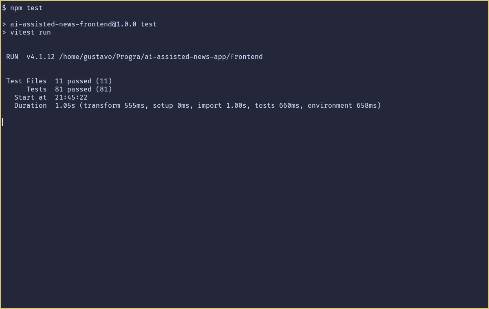
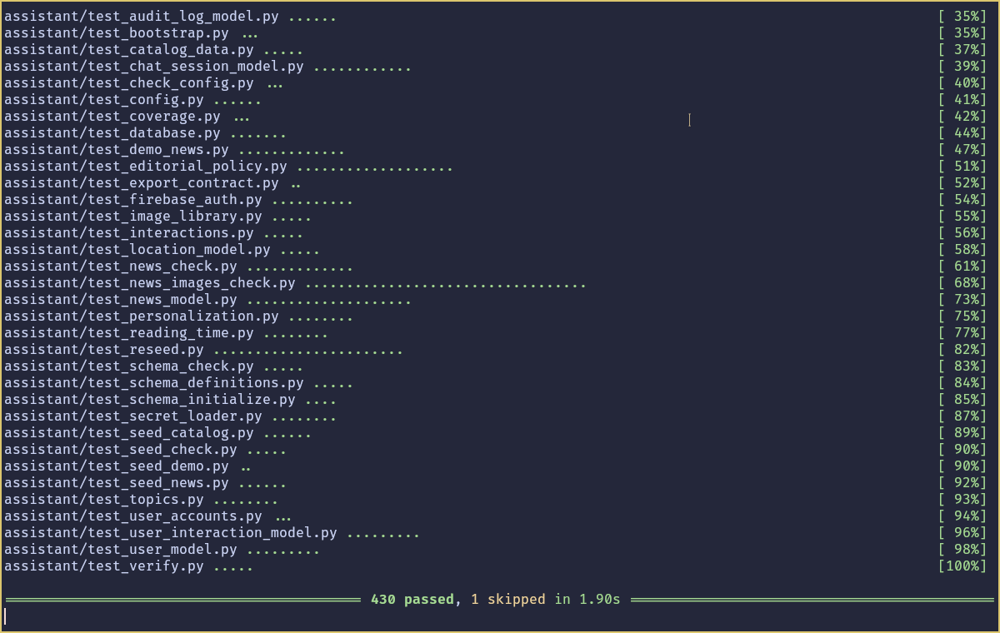

# 3 Pruebas automatizadas con Jest
Registren al menos tres pruebas unitarias de funciones de su proyecto.

| No. | Función y caso probado | Resultado esperado | Resultado obtenido |
| :---: | --- | --- | --- |
| 1 | `shortArticleReadComplete` en `frontend/tests/readingProgress.test.ts`. Artículo corto que cabe completo en pantalla con 4 y con 5 segundos de lectura activa | Con 4 segundos devuelve falso y con 5 segundos devuelve verdadero. Si el artículo no se ve completo, devuelve falso aunque pasen 10 segundos | Cumplido, la prueba pasa |
| 2 | `estimate_reading_minutes` en `backend/news/tests/test_reading_time.py`. Cantidades de 0, 150, 200 y 300 palabras | 0, 150 y 200 palabras dan 1 minuto y 300 palabras dan 2 minutos, redondeando hacia arriba | Cumplido, la prueba pasa |
| 3 | `readConversations` en `frontend/tests/chatHistory.test.ts`. Lista con una conversación vigente, una vencida y una de otro usuario | Devuelve solo la conversación vigente del usuario actual | Cumplido, la prueba pasa |

Ejecución e integración: En el frontend se ejecuta `npm test`, que lanza Vitest en modo de una sola corrida. En el backend se ejecuta `pytest assistant/tests news/tests` desde la carpeta `backend`. En CI los mismos comandos corren en los jobs `frontend` y `test` en cada pull request y en cada push a `main`, y bloquean el despliegue si alguno falla.

Estado y decisión: Implementado. Hay 81 pruebas en 11 archivos de frontend y 430 en backend, con 1 omitida, todas las demás aprobadas. Los tres archivos de la tabla también pasan por separado: 7 pruebas en los dos archivos de frontend y 8 en el de backend. Elegimos estos casos porque son funciones puras que no dependen de red ni de base de datos, y porque cubren reglas visibles para el usuario: cuándo se marca una noticia como leída, cuánto tarda en leerse y qué conversaciones del chat se restauran. Usamos Vitest en lugar de Jest porque el frontend es un proyecto Expo con TypeScript, y Vitest ofrece la misma sintaxis de `describe`, `it` y `expect`. Este motivo está pendiente de confirmar con Mathew.

Responsable y fecha: Gustavo Adolfo Cruz Bardales, 13 de noviembre de 2026.

Evidencia:

1. Archivos de prueba: [`readingProgress.test.ts`](../../../../frontend/tests/readingProgress.test.ts), [`test_reading_time.py`](../../../../backend/news/tests/test_reading_time.py) y [`chatHistory.test.ts`](../../../../frontend/tests/chatHistory.test.ts).
2. Salida de Vitest, commit `6b1c02a`: [resultado-vitest-2026-11-13.txt](evidencias/resultado-vitest-2026-11-13.txt).
3. Salida de pytest, commit `6b1c02a`: [resultado-pytest-2026-11-13.txt](evidencias/resultado-pytest-2026-11-13.txt).
4. Captura de Vitest con 11 archivos y 81 pruebas aprobadas:

   

5. Captura de pytest con 430 aprobadas y 1 omitida:

   
