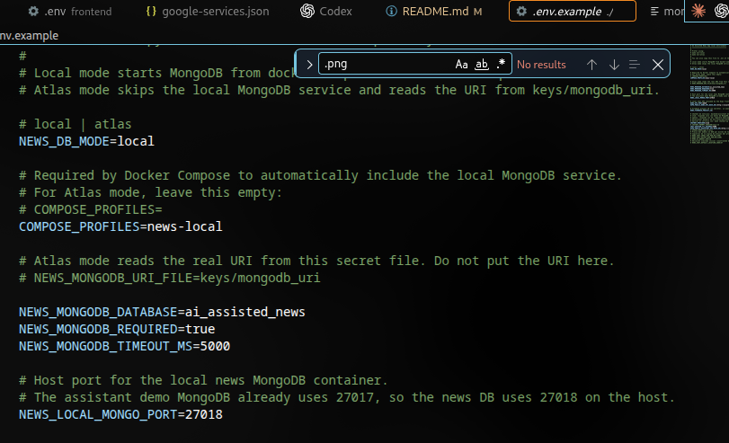
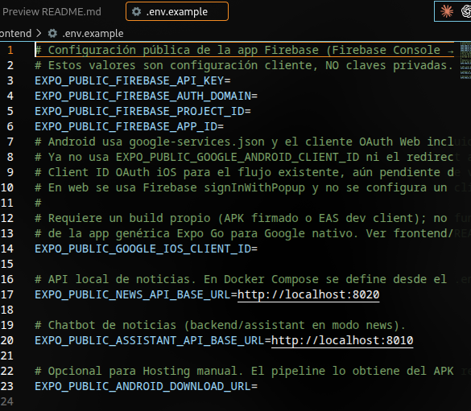
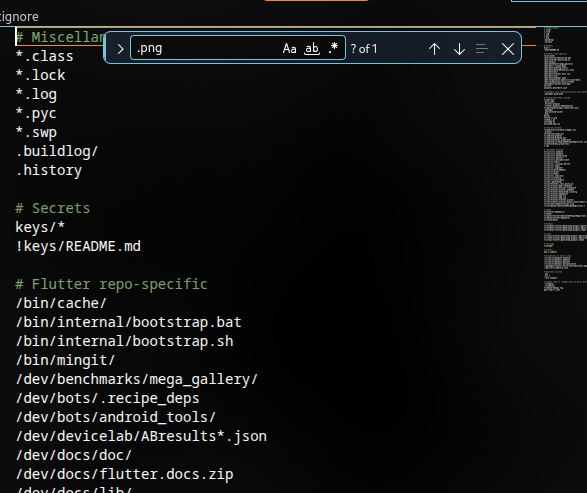
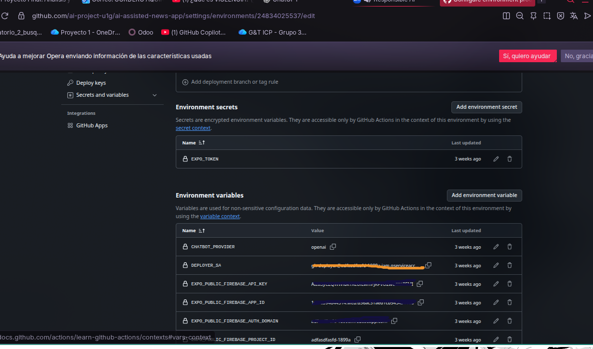
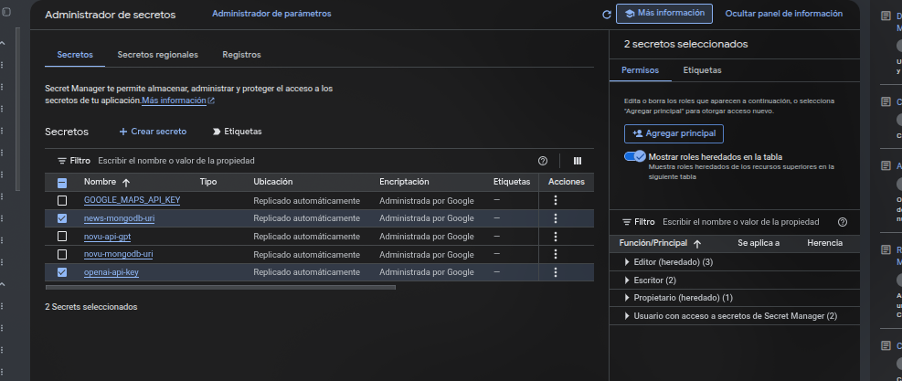

# 4. Gestión de configuración

**Configuración local y en la nube:** En desarrollo, [`.env.example`](../../../../.env.example) describe la selección de MongoDB local o Atlas (`NEWS_DB_MODE`), el nombre de la base (`NEWS_MONGODB_DATABASE`), los puertos locales, las URLs de la API y el chat, el proveedor del chatbot (`CHATBOT_PROVIDER`) y la vigencia de las sesiones (`CHAT_SESSION_TTL_SECONDS`). [`frontend/.env.example`](../../../../frontend/.env.example) añade las variables públicas de Firebase y las URLs usadas por el cliente. El `.env` local se reserva para parámetros no secretos; las credenciales se guardan en archivos bajo `keys/`.

| Configuración | Dónde se administra en producción |
| --- | --- |
| Proyecto, región, modelo, precios de IA y variables públicas de Firebase | **GitHub → Settings → Environments → production → Environment variables**; el [workflow](../../../../.github/workflows/deploy.yml) las entrega al despliegue. |
| `NEWS_DB_MODE=atlas`, `NEWS_MONGODB_DATABASE`, `NEWS_FIREBASE_PROJECT_ID`, `CHATBOT_PROVIDER`, `CHAT_SESSION_TTL_SECONDS` y rutas de archivos de credenciales | Variables de los servicios `news-api` y `news-chatbot` en **Google Cloud Run**, definidas por el [script de despliegue](../../../../deploy/gcp/deploy.sh). |
| URI de MongoDB y clave de OpenAI | **Google Cloud Secret Manager**; Cloud Run las monta como archivos. No se publican sus valores en GitHub ni en `.env`. |
| `EXPO_TOKEN` | **GitHub → Settings → Environments → production → Environment secrets**, para construir el APK. |
| Variables públicas `EXPO_PUBLIC_*` del APK | Entorno **production** del proyecto Expo EAS, separado del entorno de GitHub. |

**Decisión y separación de entornos:** El desarrollo usa `.env` y, por defecto, MongoDB local; el uso de Atlas se selecciona explícitamente. Producción publica la web en Firebase Hosting, ejecuta la API y el chat en Cloud Run, y usa la base `ai_assisted_news` en MongoDB Atlas. Los comandos cloud toman los parámetros del entorno y de [`deploy/gcp/config.sh`](../../../../deploy/gcp/config.sh), sin cargar el `.env` raíz. Esto evita enviar puertos y URLs locales a producción y mantiene la base de noticias separada de la base histórica `assistant`.

**Estado y resultado:** **En proceso.** Se analizaron los archivos de configuración del repositorio y se verificó la separación entre desarrollo y producción. Las capturas muestran variables y el nombre del secreto `EXPO_TOKEN` en GitHub, además de los nombres de los secretos de MongoDB y OpenAI en Secret Manager, sin mostrar sus valores. La captura de Google Cloud corresponde a Secret Manager; queda pendiente comprobar en la consola las variables efectivas de los servicios Cloud Run. No se ejecutó un despliegue para este apartado.

**Responsable y fecha:** Mathew Alexander Cordero Aquino — 13 de noviembre de 2026.

**Evidencia:**

- [`.env.example`](../../../../.env.example): captura de los nombres de las variables locales, sin abrir el `.env` real.

  

- [`frontend/.env.example`](../../../../frontend/.env.example): captura de las variables públicas de Firebase y las URLs de API.

  

- [`.gitignore`](../../../../.gitignore): la captura muestra la exclusión de `keys/*`. Las reglas de `.env`, visibles en el archivo enlazado, son:

  ```gitignore
  .env
  .env.*
  !.env.example
  ```

  

- [Workflow de producción](../../../../.github/workflows/deploy.yml): extracto del job `deploy`, que usa el entorno `production` y lee variables de GitHub.

  ```yaml
      environment: production
      permissions:
        contents: read
        id-token: write
      env:
        # Variables del entorno production en GitHub; ninguna contiene secretos.
        WIF_PROVIDER: ${{ vars.WIF_PROVIDER }}
        DEPLOYER_SA: ${{ vars.DEPLOYER_SA }}
        PROJECT_ID: ${{ vars.GCP_PROJECT_ID }}
        NEWS_FIREBASE_PROJECT_ID: ${{ vars.NEWS_FIREBASE_PROJECT_ID }}
        REGION: ${{ vars.GCP_REGION }}
  ```

  El token de Expo se toma de `secrets.EXPO_TOKEN` en el paso de compilación del APK.

- [Script de Cloud Run](../../../../deploy/gcp/deploy.sh): extracto que muestra la referencia al secreto MongoDB y el montaje condicional de la clave OpenAI. Son **nombres y rutas**, no valores de credenciales.

  ```bash
    --set-secrets "/secrets/mongodb/uri=${SECRET_MONGODB_URI}:latest" \
    --set-env-vars "^|^NEWS_DB_MODE=atlas|NEWS_MONGODB_DATABASE=${NEWS_MONGODB_DATABASE}|NEWS_MONGODB_REQUIRED=true|NEWS_MONGODB_URI_FILE=/secrets/mongodb/uri|NEWS_FIREBASE_PROJECT_ID=${NEWS_FIREBASE_PROJECT_ID}|NEWS_API_ALLOWED_ORIGINS=${NEWS_API_ALLOWED_ORIGINS}"
  ```

  ```bash
  chatbot_secrets="/secrets/mongodb/uri=${SECRET_MONGODB_URI}:latest"
  if [[ "$CHATBOT_PROVIDER" == "openai" ]]; then
    chatbot_secrets+=",/secrets/openai/key=${SECRET_OPENAI_API_KEY}:latest"
  fi
  ```

- [Parámetros cloud](../../../../deploy/gcp/config.sh): extracto de configuración no secreta usada en producción.

  ```bash
  CHATBOT_PROVIDER="${CHATBOT_PROVIDER:-openai}"
  OPENAI_MODEL="${OPENAI_MODEL:-gpt-5-mini}"
  # Precios del modelo en USD por millón de tokens. Obligatorios con openai.
  NEWS_CHAT_INPUT_USD_PER_MILLION="${NEWS_CHAT_INPUT_USD_PER_MILLION:-}"
  NEWS_CHAT_OUTPUT_USD_PER_MILLION="${NEWS_CHAT_OUTPUT_USD_PER_MILLION:-}"
  NEWS_AI_BUDGET_USD="${NEWS_AI_BUDGET_USD:-20}"
  ```

- **GitHub → Settings → Environments → production:** la captura muestra los nombres de *Environment variables* y el secreto `EXPO_TOKEN`, sin mostrar el valor del secreto.

  

- **Google Cloud → Secret Manager:** la captura muestra los nombres de `news-mongodb-uri` y `openai-api-key`, sin abrir ni mostrar sus valores. No corresponde a la pantalla de variables de Cloud Run.

  
