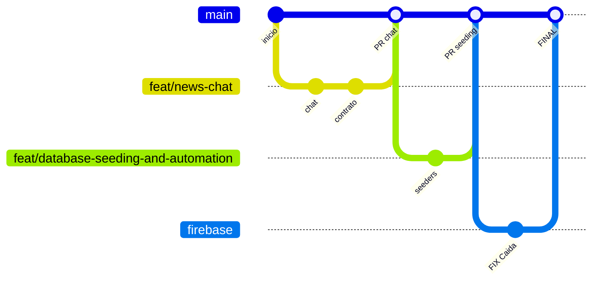
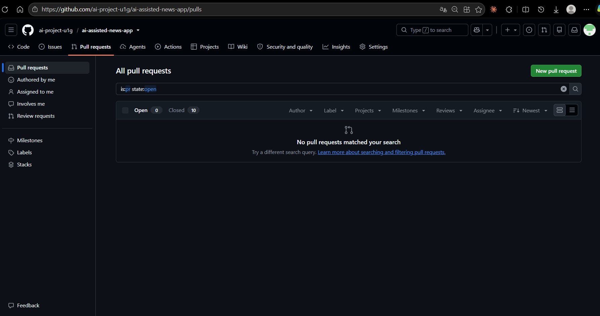

# 5 Gestión de versionamiento con Git

**Estado:** Implementado. Las brechas detectadas tienen propuesta de mejora (ver al final).

**Prácticas aplicadas:**

- **Flujo de ramas GitHub Flow.** `main` es la rama estable y la única que publica a producción (Cloud Run y Firebase Hosting). Cada funcionalidad se desarrolla en una rama propia, por ejemplo `feat/news-chat`, `feat/database-seeding-and-automation` y `firebase`.
- **Integración por pull request.** Los cambios entran a `main` mediante PR. El pipeline (`.github/workflows/deploy.yml`) ejecuta todas las pruebas en cada PR, y el despliegue ocurre únicamente después de integrar a `main`.
- **Conventional Commits.** La regla está escrita en `AGENTS.md`: *«Usar Conventional Commits siguiendo el estilo existente del repositorio»*. Se usan los tipos `feat`, `fix`, `docs` y `chore`, con alcance cuando aplica: `feat(deploy)`, `feat(news)`.
- **Todo como código.** Infraestructura (`docker-compose.yml`, `Makefile`, `deploy/gcp/`, `deploy/firebase/`), decisiones de arquitectura (ADR `docs/decisions/0001-api-principal-y-seguridad.md`), diagramas en Mermaid y el contrato API-frontend (`make news-contract-check`) viven en el repositorio.
- **Secretos fuera del historial.** `.gitignore` excluye `keys/*` y todos los `.env`, salvo la plantilla `.env.example`.



*Diagrama simplificado del flujo de ramas. El historial completo está en las Figuras 1 y 2.*

**Decisión:** Elegimos GitHub Flow porque el proyecto tiene un solo entorno productivo y despliega de forma continua desde `main`. Git Flow agrega ramas `develop` y `release` que solo se justifican cuando hay varias versiones en paralelo, y aquí habrían sumado pasos sin beneficio. Conventional Commits deja un historial legible y permite generar después el CHANGELOG y las versiones SemVer de forma automática.

**Estado y resultado** (al 13 de noviembre de 2026):

| Indicador | Valor |
|---|---|
| Commits en `main` | 75 (desde el 4 de septiembre de 2026) |
| Pull requests integrados | 10 (#2 a #11) |
| Commits que cumplen Conventional Commits | 68 % (43 de 63, sin contar merges) |
| Versión declarada de la app | `1.0.0` en `frontend/package.json` |
| Tags o releases | Ninguno |

Brechas detectadas:

- **Sin tags ni releases.** No se puede volver a «la versión entregada» por nombre.
- **Convención aplicada de forma parcial.** Hay commits fuera del formato, por ejemplo «FINAL», «FIX Caida», «USE DE FEED» y «[FEAT] …».
- **`main` no está protegida.** El cambio de la rama `firebase` («FIX Caida») entró a `main` con un merge local («FINAL», 30 de octubre) sin pull request ni revisión de otro integrante, como muestra la Figura 1.
- **Ramas ya integradas sin borrar:** `feat/database-seeding-and-automation` y `firebase`.

**Responsable y fecha:** José Luis Gramajo · 13 de noviembre de 2026

**Evidencia:**

*Historial de commits y ramas (`git log --graph`):*


*Figura 1. `main` en `7fe4914`. La rama `firebase` (`fd33d7c`, «FIX Caida») se integra a `main` con el merge «FINAL» del 30 de octubre; antes aparece el merge del PR #10.*


*Figura 2. Merge del PR #10 («FEAT> Completado apk (#10)»): la rama de trabajo (`27f8cec`) se une a `main` mediante un commit con dos padres.*

*Solicitudes de integración:*



*Figura 3. Pestaña Pull requests (captura tomada antes de integrar el PR #11).*

Ejemplos de PR integrados: [#10 Completado apk](https://github.com/ai-project-u1g/ai-assisted-news-app/pull/10) · [#11 Estructura del plan ITIL y DevOps](https://github.com/ai-project-u1g/ai-assisted-news-app/pull/11)

*Secretos excluidos (`.gitignore`):*

```gitignore
# Secrets            (líneas 10-12)
keys/*
!keys/README.md

# Secretos locales   (líneas 123-126)
.env
.env.*
!.env.example
```

## Propuesta de mejora

| Prioridad | Mejora | Cómo |
|:---:|---|---|
| 1 | Etiquetar la entrega con SemVer | `git tag -a v1.0.0 -m "Entrega Proyecto Final"` y `git push origin v1.0.0`; luego publicar un GitHub Release. El workflow solo se dispara con push a `main`, así que el tag no redespliega. |
| 2 | Proteger `main` | Exigir pull request, una aprobación y el pipeline en verde antes de permitir el merge. |
| 3 | Automatizar la convención | commitlint con un hook de husky que valide el formato antes de cada commit. |
| 4 | CHANGELOG automático | Generarlo desde los Conventional Commits, por ejemplo con release-please. |
| 5 | Limpieza de ramas | Borrar las ramas integradas y activar *Automatically delete head branches*. |
