# 6 Gestión de seguridad DevSecOps

**Estado:** Implementado. Los controles corren en cada pull request, en `main` y cada semana. Las
brechas restantes tienen propuesta de mejora (ver al final).

## Riesgos identificados

| Riesgo | Ejemplo en el proyecto |
| --- | --- |
| Dependencias con vulnerabilidades conocidas | `node-forge`, `shell-quote` (crítica) y otras 24 en el frontend; `urllib3` y `msgpack` dentro de las imágenes de Cloud Run |
| Secretos expuestos en el repositorio público | API key de Firebase en `frontend/google-services.json`, detectada por GitHub desde el 21 de octubre |
| Código inseguro | Inyección, validación insuficiente u otros patrones que solo se ven leyendo el código |
| Configuración insegura de la API en ejecución | Cabeceras de seguridad faltantes, rutas expuestas |
| Imágenes de contenedor con más de lo necesario | La imagen de `news-api` incluía pip y herramientas de prueba en producción |
| Cambios sin revisión | `main` no está protegida y admite cambios directos |

## Controles y herramientas

Todo corre en contenedores o en servicios gratuitos para repositorios públicos, sin cuentas
externas. Los controles nuevos están en `.github/workflows/security.yml`, separado de
`deploy.yml`, para que la seguridad sea un gate propio y no se mezcle con el despliegue.

| Etapa | Control | Herramienta | Qué detiene |
| --- | --- | --- | --- |
| Código | SAST | CodeQL (Python y TypeScript, consultas `security-extended`) | Patrones de código inseguro |
| Código | Secretos en el historial | gitleaks (contenedor, todas las ramas, salida redactada; excepciones justificadas en `.gitleaks.toml` y `.gitleaksignore`) | Credenciales commiteadas |
| Código | Secretos al hacer push | GitHub secret scanning + push protection | Bloquea el push antes de que el secreto entre |
| Dependencias | SCA | Trivy fs, pip-audit, Dependabot alerts | Paquetes con CVE conocidas |
| Dependencias | Actualización | Dependabot security y version updates (agrupadas, sin saltos mayores) | Deriva de versiones |
| Build | Escaneo de imágenes | Trivy image sobre `news-api` y `news-chatbot`, construidas como en `deploy/gcp/deploy.sh` | Vulnerabilidades del sistema operativo y de Python en lo que se despliega |
| Pruebas | DAST | OWASP ZAP (`zap-api-scan`) contra la API levantada en una red Docker interna con MongoDB efímera | Fallas visibles solo con la app corriendo |
| Despliegue | Credenciales | Workload Identity Federation, Secret Manager, una cuenta de servicio por servicio | Llaves de larga duración en GitHub |
| Cadena de suministro | Versiones fijas | Acciones de `security.yml` fijadas por SHA e imágenes de las herramientas con versión fija (Trivy, gitleaks, ZAP), actualizadas por Dependabot | Una etiqueta movida o una versión nueva que cambie resultados sin aviso |
| Gobierno | Política de seguridad | `SECURITY.md` con el reporte privado de vulnerabilidades de GitHub, plazos y alcance | Reportes públicos de vulnerabilidades sin corregir |

Criterio de corte: Trivy falla con hallazgos altos o críticos que ya tienen corrección publicada, y
ZAP falla con alertas de riesgo alto. Los reportes se suben a la pestaña Security (SARIF) y el de
ZAP queda como artefacto del job.

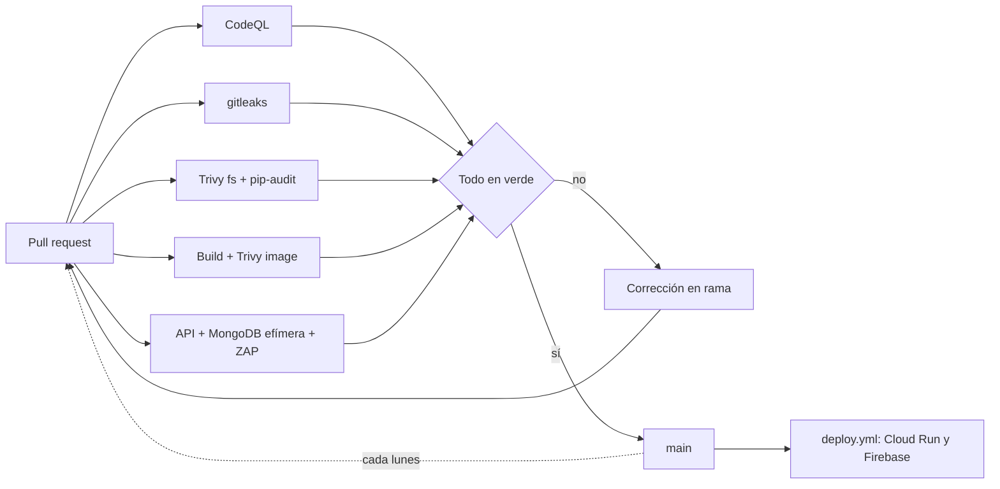

Comandos locales equivalentes: `make security-dast` y la línea base en
`evidencias/linea-base-2026-11-13.md`.

## Decisión

- **CodeQL en lugar de SonarQube.** Cumple el mismo papel de análisis estático visto en clase, es
  gratuito en repositorios públicos y no requiere servidor ni token. SonarCloud quedó como
  alternativa equivalente.
- **Trivy y pip-audit en lugar de Snyk.** Cubren el análisis de dependencias sin cuenta externa. Trivy
  además analiza la imagen construida: ahí encontró `urllib3` y `msgpack` vulnerables dentro de pip,
  que pip-audit no ve porque solo lee `requirements.txt`.
- **Contenedores en el pipeline.** Cada escáner corre con una versión fija de su imagen Docker, y el
  DAST levanta la misma imagen que se publica en Cloud Run. Así se analiza lo que realmente se
  despliega.
- **Workflow separado.** `security.yml` no modifica el pipeline de CI/CD del equipo y se puede exigir
  como check independiente.

## Estado y resultado

Del 13 de noviembre de 2026, antes y después de los PR
[#13](https://github.com/ai-project-u1g/ai-assisted-news-app/pull/13),
[#37](https://github.com/ai-project-u1g/ai-assisted-news-app/pull/37),
[#40](https://github.com/ai-project-u1g/ai-assisted-news-app/pull/40),
[#43](https://github.com/ai-project-u1g/ai-assisted-news-app/pull/43) y
[#44](https://github.com/ai-project-u1g/ai-assisted-news-app/pull/44).

| Indicador | Antes | Después |
| --- | --- | --- |
| Checks del workflow `security` | 3 de 6 en rojo | 7 de 7 en verde (se agregó DAST) |
| Alertas de code scanning | 18 altas | 0 |
| Alertas de Dependabot abiertas | 78 | 0 (77 corregidas, 2 descartadas con justificación) |
| Alertas de secret scanning abiertas | 1 | 0 |
| npm audit del frontend | 19 (1 crítica, 6 altas) | 5 moderadas sin corrección compatible |
| Alertas de ZAP | 1 baja | 0 altas, medias ni bajas |
| Imagen `news-api` | 308 MB, con pip y herramientas de prueba | 284 MB, solo `backend/news` y sin pip |
| Android key de Firebase | Sin restricción de app, 27 APIs | Solo `com.aina.news` + SHA-1, 3 APIs |

### Hallazgos y correcciones

| Hallazgo | Corrección | PR |
| --- | --- | --- |
| 26 vulnerabilidades del frontend en dependencias de Expo | `npm audit fix` y Expo 57.0.33, alineado con `expo install --fix` | #37 |
| `urllib3`, `msgpack` y `setuptools` vendorizados en pip; `zlib1g` sin parche | Imágenes de runtime sin pip y con parches del sistema; etapa `runtime` separada de `tools` | #37 |
| `Referncias/`, proyecto ajeno sin uso con 41 alertas | Eliminado del repositorio | #37 |
| Android key de Firebase sin restricciones | Restringida a la app y a 3 APIs, como cambio autorizado. Ver [hallazgo](evidencias/hallazgo-firebase-api-key.md) | #40 |
| Dependabot propuso React Native 0.88, incompatible con el SDK 57 | El typecheck del CI rechazó el PR #39; se excluyeron los paquetes fijados por Expo | #40 |
| ZAP: falta `X-Content-Type-Options` | La API envía `nosniff` en todas las respuestas, con prueba | #43 |
| gitleaks marcó el nombre temporal del contenedor en el reporte de ZAP | Alias fijo `news-api` en el script y excepción por patrón en `.gitleaks.toml`. Primero se usaron huellas en `.gitleaksignore`, pero incluyen el SHA del commit y dejaron de coincidir tras el squash merge | #44, #45 |
| Avisos «Node.js 20 is deprecated» en el run de `main` (Figura 13): `actions/checkout@v4` y `setup-python@v5` corren sobre Node 20, que GitHub retira | `security.yml` usa `checkout` v7.0.1, `setup-python` v7.1.0 y `upload-artifact` v7.0.2 (Node 24), fijadas por SHA. `deploy.yml` mantiene v4: se propone al responsable de CI/CD | #49 |
| `minimatch` y `uuid` sin versión compatible con Expo 57 | Descartadas en Dependabot: riesgo tolerable (patrones propios en build) y código no usado (`uuid.v4()` sin `buf`) | - |

**Responsable y fecha:** Josué Say · 13 de noviembre de 2026. La restricción de la API key la
autorizó Mathew Cordero, responsable de Firebase.

## Relación con ITIL

| Práctica de ITIL | Aplicación concreta |
| --- | --- |
| Gestión de la seguridad de la información | Tríada CIA en el pipeline: confidencialidad (secretos y keys), integridad (dependencias e imágenes verificadas), disponibilidad (DoS en dependencias y cabeceras) |
| Habilitación de cambios | Cada corrección entra por pull request con checks automáticos como evaluación de riesgo. La restricción de la key siguió el flujo completo: solicitud, riesgo, plan de reversa, autorización, implementación, verificación y cierre ([registro](evidencias/hallazgo-firebase-api-key.md#registro-del-cambio)) |
| Gestión de riesgos | Cada hallazgo se trató con una de las estrategias vistas en clase: eliminar (corregir dependencias), minimizar (restringir la key) o aceptar con justificación (`minimatch`, `uuid` y vulnerabilidades del sistema sin corrección de Debian) |
| Mejora continua | El escaneo semanal detecta CVE nuevas sin cambios de código, y Dependabot propone las actualizaciones. Las 9 actualizaciones de Python que propuso se integraron en un solo cambio probado ([#48](https://github.com/ai-project-u1g/ai-assisted-news-app/pull/48)) en lugar de 9 despliegues separados, y las del frontend agrupadas en [#41](https://github.com/ai-project-u1g/ai-assisted-news-app/pull/41) |

Seguimiento: el workflow `security` corre cada lunes. Quien integre a `main` revisa la pestaña
Security; un hallazgo alto con corrección bloquea el pipeline hasta resolverlo.

## Evidencia

### Línea base y primer escaneo

- [Línea base](evidencias/linea-base-2026-11-13.md): escaneo inicial con contenedores sobre los archivos versionados.

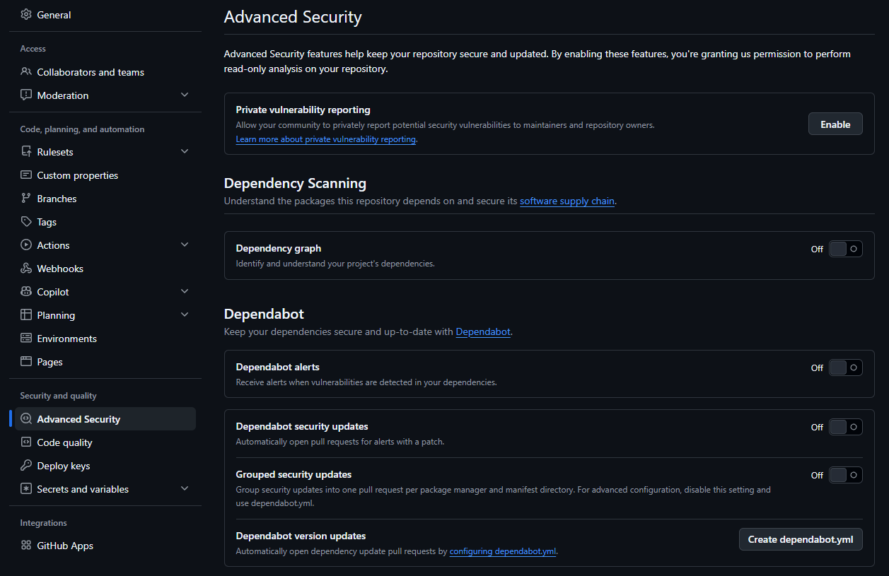

*Figura 1. Dependency graph y Dependabot desactivados antes de los controles.*

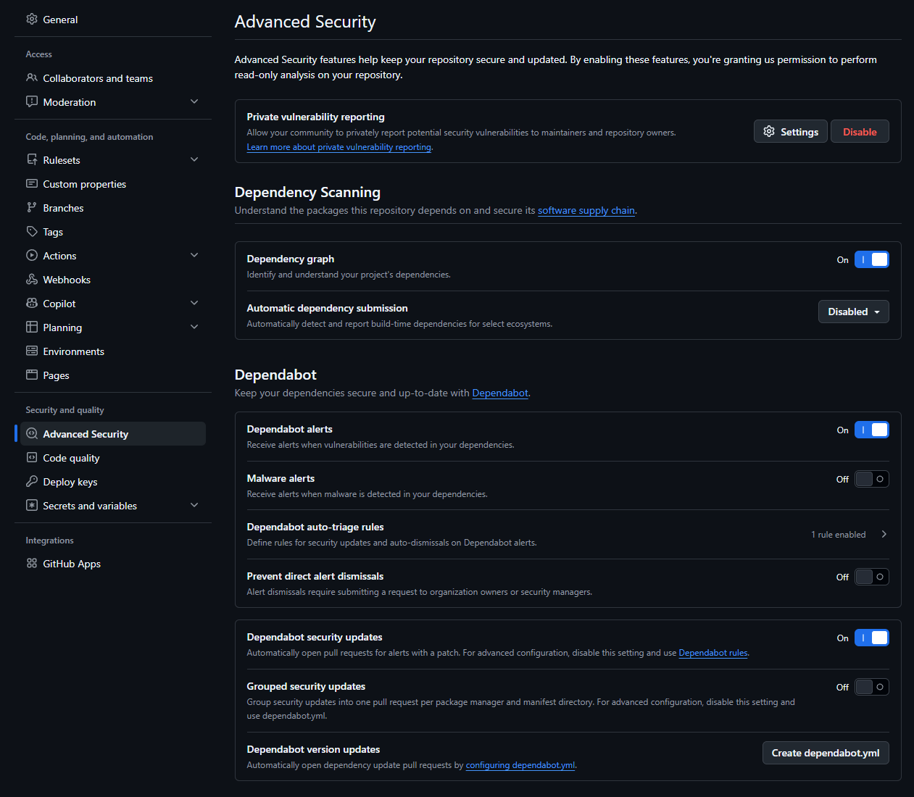

*Figura 2. Dependency graph, Dependabot alerts, security updates y private vulnerability reporting activados.*

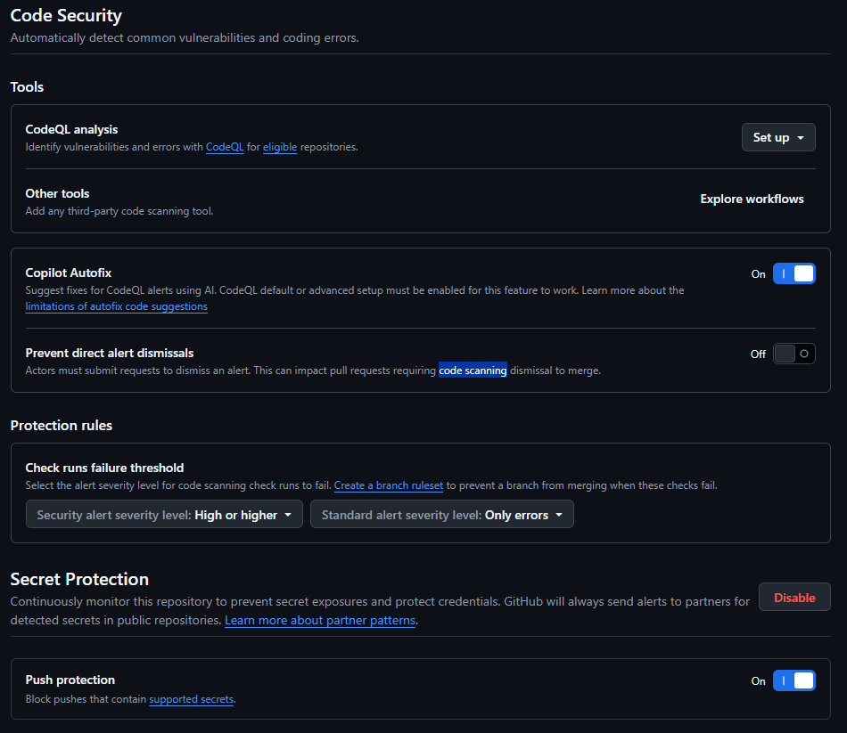

*Figura 3. Secret Protection con push protection activado.*

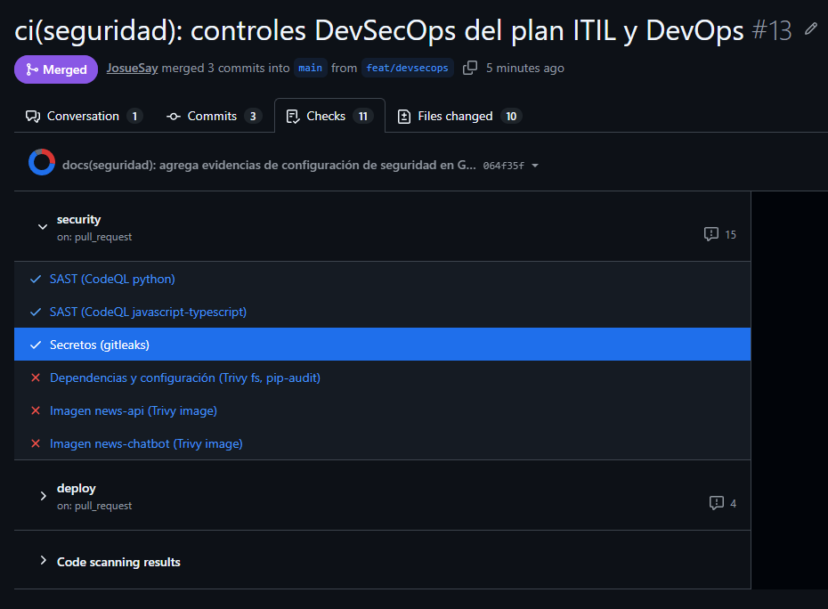

*Figura 4. Primera corrida: Trivy detiene el PR en dependencias e imágenes.*

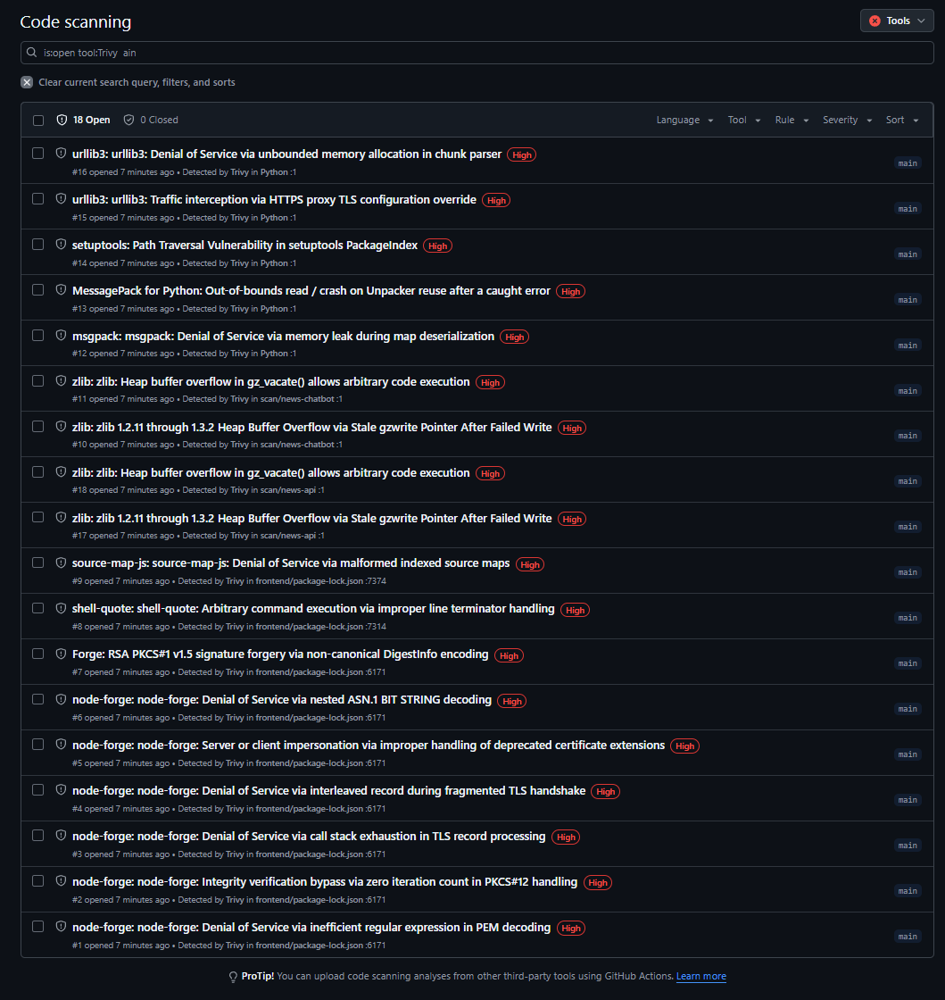

*Figura 5. 18 alertas altas de Trivy en la pestaña Security.*

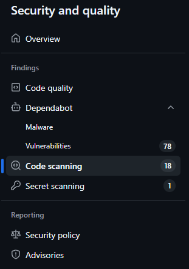

*Figura 6. 78 alertas de Dependabot, 18 de code scanning y 1 de secret scanning.*

### Correcciones

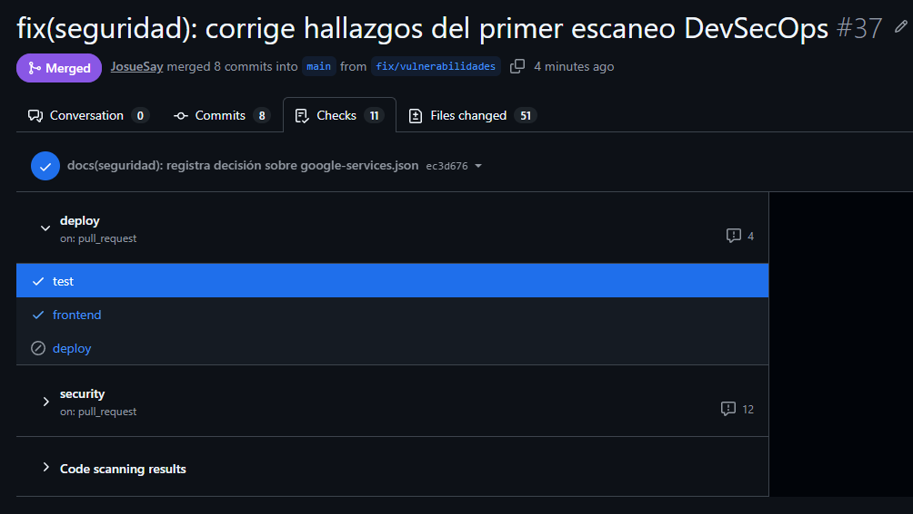

*Figura 7. PR #37 con las correcciones: todos los checks en verde.*

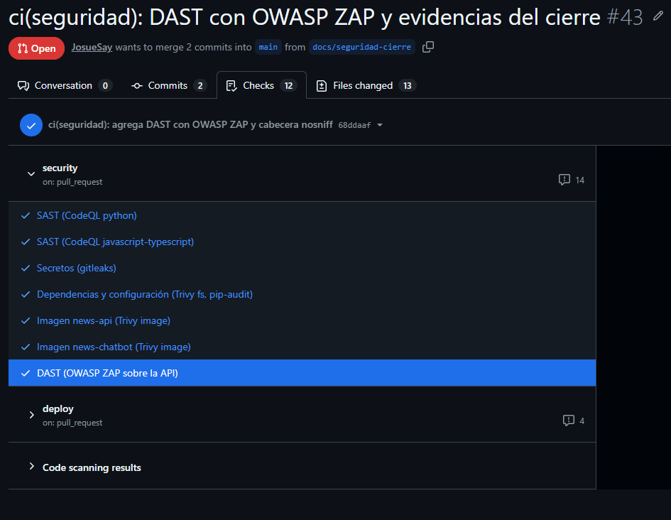

*Figura 8. PR #43: el job DAST se suma a los controles.*

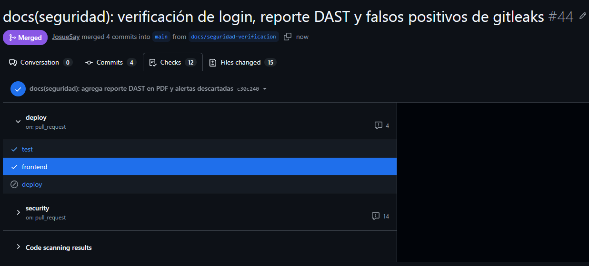

*Figura 9. PR #44: verificación de login, reporte DAST y falsos positivos de gitleaks resueltos.*

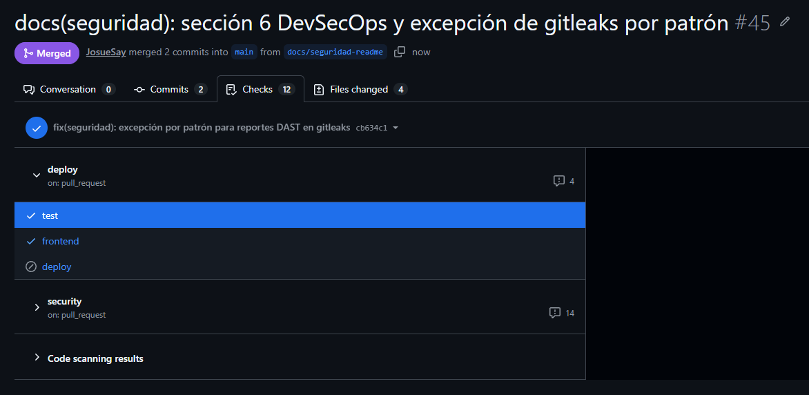

*Figura 10. PR #45: excepción de gitleaks por patrón; el job de secretos vuelve a verde en todas las ramas.*

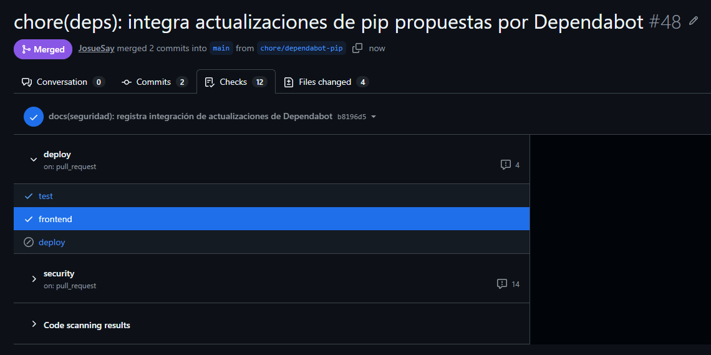

*Figura 11. PR #48: las 9 actualizaciones de Python de Dependabot integradas en un solo cambio, con todos los controles en verde.*

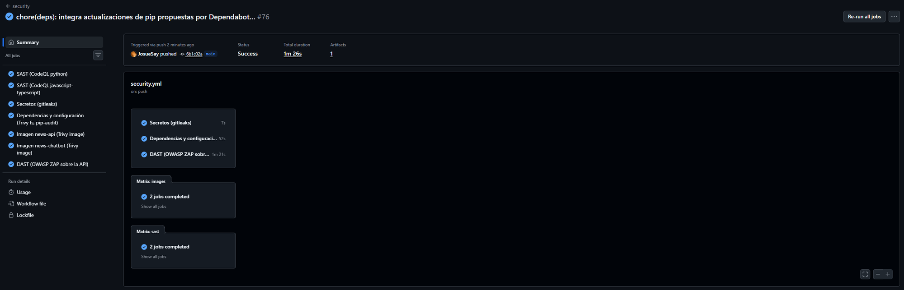

*Figura 12. Workflow `security` en `main` después del PR #48: 7 de 7 jobs en verde.*

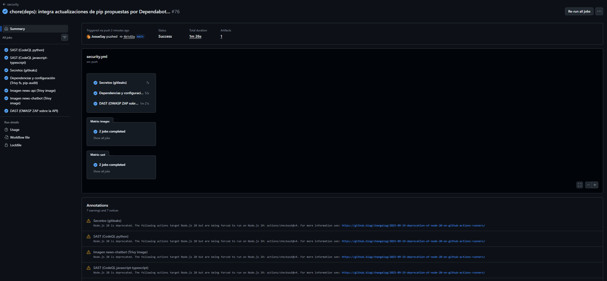

*Figura 13. Anotaciones del mismo run: avisos de deprecación de Node.js 20 en las acciones, corregidos en el PR #49.*

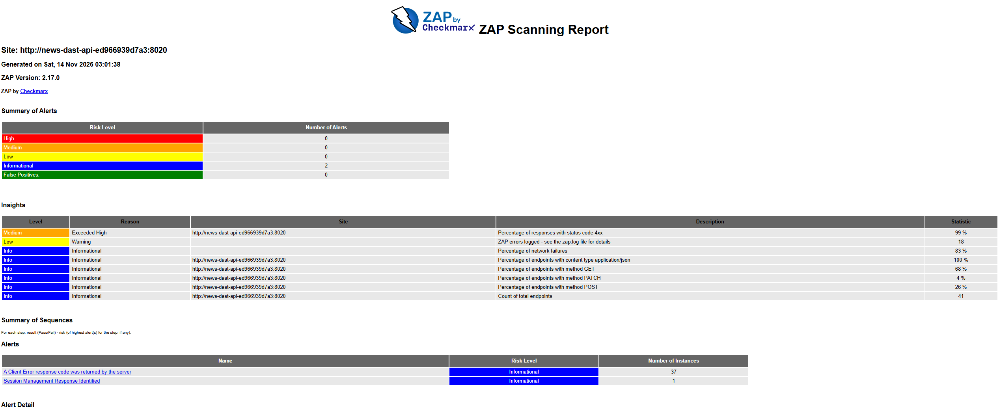

*Figura 14. Reporte de ZAP: 0 alertas altas, medias y bajas. Reporte completo en [HTML](evidencias/dast/zap-report.html) y [PDF](evidencias/dast/zap-reporte.pdf).*

### Estado final

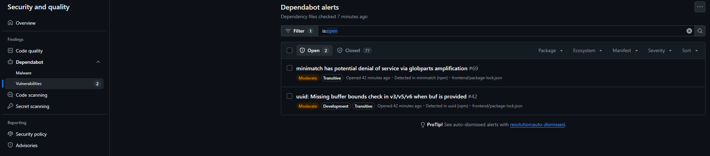

*Figura 15. Dependabot con 77 alertas cerradas por las correcciones.*

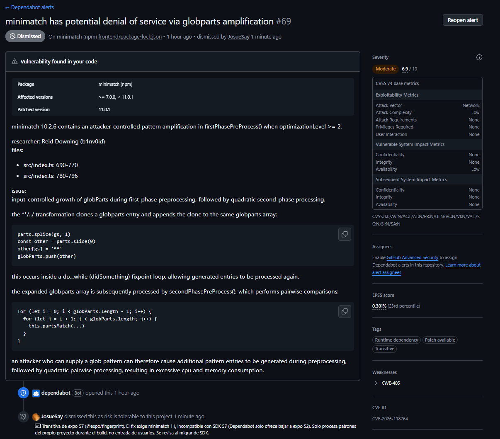

*Figura 16. `minimatch` descartada como riesgo tolerable, con justificación.*

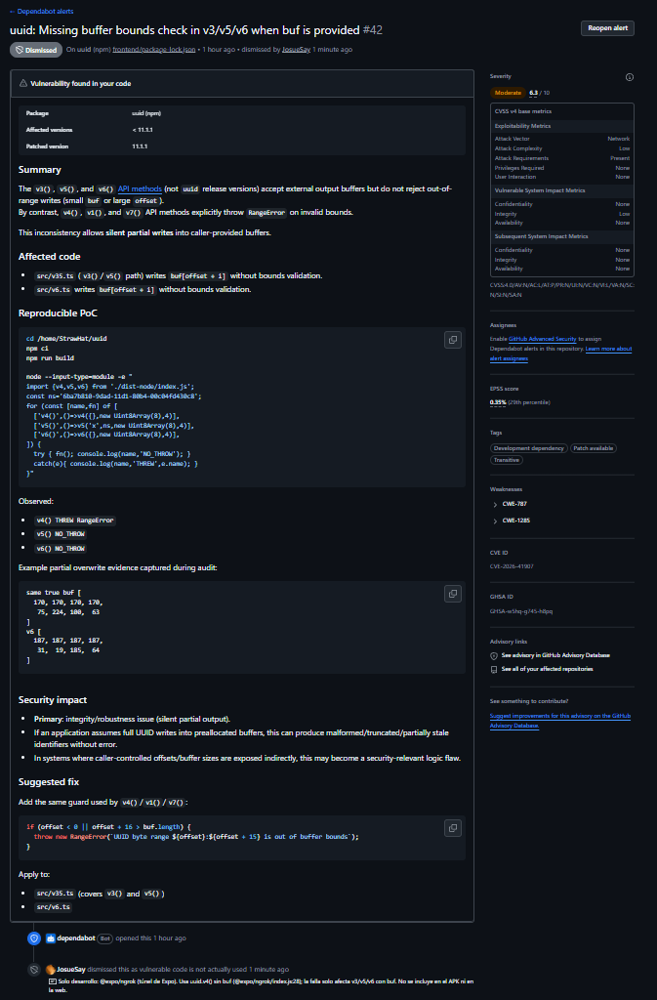

*Figura 17. `uuid` descartada como código vulnerable no usado, con justificación.*

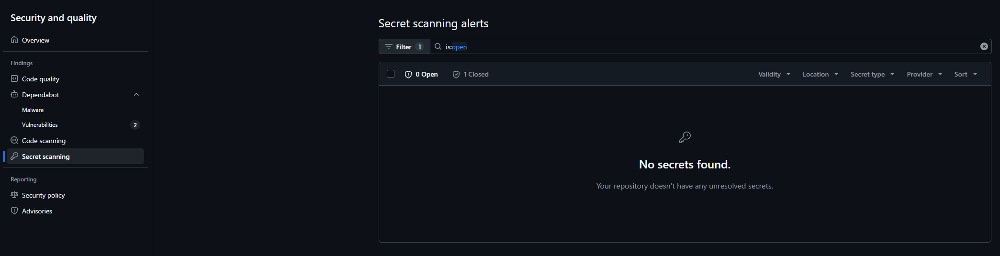

*Figura 18. Secret scanning sin alertas abiertas.*

Las evidencias de la API key (restricción, login en web y Android) están en el
[documento del hallazgo](evidencias/hallazgo-firebase-api-key.md).

## Propuesta de mejora

| Prioridad | Mejora | Cómo |
| :---: | --- | --- |
| 1 | Proteger `main` | Ruleset con pull request obligatorio, una aprobación y los checks de `security` en verde, más bloqueo de force push y borrado, y `CODEOWNERS` para exigir revisión en `.github/`, `deploy/` y la configuración de seguridad. Se aplica al cerrar la entrega: mientras el equipo completa el plan, integra documentación directo a `main` y el ruleset lo bloquearía |
| 2 | Que el deploy espere a `security` | Hoy `deploy.yml` despliega en cada push a `main` aunque `security` falle. Con el ruleset ya no entra código sin checks; además, el job de deploy puede depender del resultado de `security` (`workflow_run`) |
| 3 | Desactivar `/docs` y `/openapi.json` en producción | Lo exige el ADR 0001 y hoy responden 200 en Cloud Run. `docs_url=None` y `openapi_url=None` fuera del entorno local |
| 4 | Restringir la Browser key de Firebase | Limitarla a los dominios de Firebase Hosting (referrers HTTP) |
| 5 | Fijar dependencias de Python | Lockfile con hashes (`pip-compile --generate-hashes`) para builds reproducibles |
| 6 | Monitoreo de seguridad en ejecución (DevSecMonOps) | Alertas de Cloud Monitoring por picos de 401/429 y de costo en la API del chat; rate limit en `/chat` |
| 7 | Cadena de suministro | SBOM y firma de imágenes en Artifact Registry (Trivy SBOM + cosign) |
| 8 | Migrar de SDK de Expo | Cierra `minimatch` y `uuid`, hoy aceptadas como riesgo |
