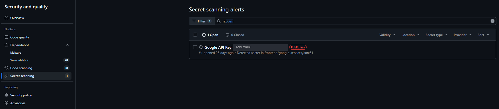
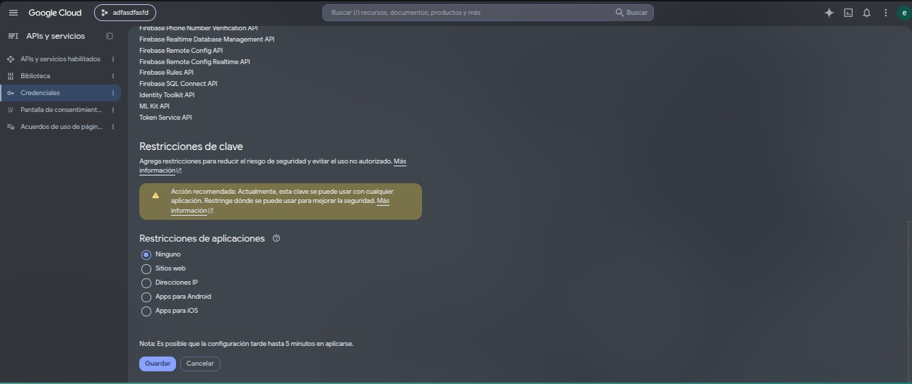

# Hallazgo: API key de Firebase en `frontend/google-services.json`

Referencia oficial: [Información sobre las claves de API de Firebase](https://firebase.google.com/docs/projects/api-keys).

## Detección

| Campo | Valor |
| --- | --- |
| Archivo | `frontend/google-services.json`, línea 31 (`api_key.current_key`) |
| Commit de entrada | `27f8cec` («FEAT> Completado apk», PR #10) |
| Detectado por | GitHub secret scanning, alerta #1 «Google API Key» (abierta el 21 de octubre de 2026), y gitleaks en la línea base (regla `gcp-api-key`) |
| Estado en GitHub | `publicly_leaked = true`: el repositorio es público y la key está en el historial |
| Key afectada | «Android key (auto created by Firebase)» del proyecto de Firebase de la app |

En este documento no se reproduce el valor de la key.

## Por qué está en el repositorio

- `frontend/app.json` declara `"googleServicesFile": "./google-services.json"` para el build Android
  con EAS.
- `deploy/expo/build-ci.sh` exige que el archivo exista en el checkout de CI antes de generar el APK.
- Google y Firebase diseñan esta key para ir embebida en la app. Cualquier usuario puede extraerla
  del APK, así que identifica al proyecto pero no autoriza por sí sola el acceso a los datos.

## Evaluación de riesgo

La key no da acceso a MongoDB, a Secret Manager ni a Cloud Run. Esos secretos están en Secret
Manager y en `keys/`, que nunca se commitea. El riesgo es el abuso de las APIs que la key permite:

- consumo de cuota o costos en las APIs habilitadas;
- registro de cuentas de Firebase Authentication desde clientes que no son la app.

Estado verificado el 13 de noviembre de 2026 con `gcloud services api-keys describe`, en modo de solo
lectura:

| Control | Estado |
| --- | --- |
| Restricción de aplicación (paquete Android + SHA-1) | Ninguna: `androidKeyRestrictions: {}` |
| Restricción de APIs | 27 APIs de Firebase y Google Cloud, entre ellas `identitytoolkit`, `securetoken`, `firestore`, `firebasestorage`, `sqladmin` y `logging` |
| Uso en la app | El archivo configura Google Sign-In en Android (`GoogleOneTapSignIn.configure({ webClientId: "autoDetect" })` en `frontend/src/services/androidGoogleSignIn.android.ts`). Firebase Authentication en JavaScript usa otra key: `EXPO_PUBLIC_FIREBASE_API_KEY` corresponde a la «Browser key (auto created by Firebase)», verificado con `gcloud services api-keys lookup`. La app no incluye un SDK nativo de Firebase que use la key de Android |

Conclusión: no se trata de una credencial privilegiada filtrada. Sin embargo, la key está más
abierta de lo necesario: aunque la app no la use para autenticar, quien la copie del repositorio
puede llamar a las 27 APIs habilitadas, incluida la de Authentication (`identitytoolkit`), desde
cualquier cliente.

## Verificación de compromiso

| Revisión | Responsable | Estado |
| --- | --- | --- |
| Restricciones de la key antes del cambio | Josué Say | Hecho, ver la tabla anterior |
| El archivo corresponde al paquete Android configurado y no contiene una clave privada de cuenta de servicio | Mathew Cordero | Hecho el 13 de noviembre de 2026; también se confirmó que el archivo no tiene `private_key` |
| Métricas de uso de la key (APIs y servicios > Credenciales > key > Métricas) desde el 21 de octubre | Mathew Cordero | Pendiente |
| Usuarios de Firebase Authentication desconocidos | Mathew Cordero | Pendiente |
| Cargos inesperados en facturación del proyecto | Mathew Cordero | Pendiente |

## Evidencias

*Figura 1. Alerta de secret scanning sobre `frontend/google-services.json:31`. En la captura se ocultó el valor de la key.*

*Figura 2. Android key antes de la corrección: restricción de aplicaciones «Ninguno» y aviso de Google Cloud recomendando restringirla.*

## Decisión

El 13 de noviembre de 2026 el equipo (Mathew Cordero, responsable de Firebase) decidió mantener
`frontend/google-services.json` en el repositorio. Es configuración pública del APK, no una
contraseña, y el build de CI la necesita. El control efectivo es restringir la key en Google Cloud.

## Propuesta

| Prioridad | Medida | Detalle |
| :---: | --- | --- |
| 1 | Restringir la key | Aplicado el 13 de noviembre de 2026; ver «Registro del cambio». |
| 2 | Cerrar la alerta #1 | Tras restringir la key, cerrar la alerta de secret scanning como «se usa en configuración pública» con la justificación de este documento. |
| 3 | Rotar la key | Solo si las métricas muestran uso ajeno: crear una key nueva restringida, regenerar `google-services.json` y eliminar la anterior. Sigue en el historial público (`27f8cec`). |

Alternativa considerada y descartada por ahora: quitar el archivo del repositorio con
`git rm --cached` y `.gitignore`, y entregarlo al CI como secreto del entorno `production` antes de
`deploy/expo/build-ci.sh`. No elimina el riesgo, porque la key ya está en el historial público y
dentro del APK, y además agrega un paso manual para cada build local.

## Registro del cambio

Cambio normal según la práctica de habilitación de cambios de ITIL: lo solicitó el hallazgo, se
evaluó el riesgo, se preparó la reversa y lo autorizó el responsable del servicio antes de aplicarlo.

| Campo | Detalle |
| --- | --- |
| Solicitud | Restringir la Android key de Firebase detectada por secret scanning (alerta #1) |
| Evaluación de riesgo | Bajo. La app web usa la Browser key, la app no tiene SDK nativo de Firebase y Google Sign-In usa el client ID de OAuth, no la API key |
| Plan de reversa | Respaldo de las restricciones anteriores (27 APIs, sin restricción de aplicación) tomado con `gcloud services api-keys describe` antes del cambio; se restauran con `gcloud services api-keys update` |
| Autorización | Mathew Cordero, responsable de Firebase y del proyecto de Google Cloud, 13 de noviembre de 2026 |
| Implementación | Josué Say, 13 de noviembre de 2026, con `gcloud services api-keys update`: aplicación Android `com.aina.news` + SHA-1 del certificado de firma (tomado de `google-services.json`), y APIs limitadas a `identitytoolkit`, `securetoken` y `firebaseinstallations` |
| Verificación | `gcloud services api-keys describe` muestra 1 aplicación Android permitida y 3 APIs. Pendiente: probar el inicio de sesión con Google en el APK |
| Cierre | Cerrar la alerta #1 de secret scanning con la justificación de este documento |

| Control | Antes | Después |
| --- | --- | --- |
| Restricción de aplicación | Ninguna | Android: `com.aina.news` + SHA-1 |
| APIs permitidas | 27 | 3 |
