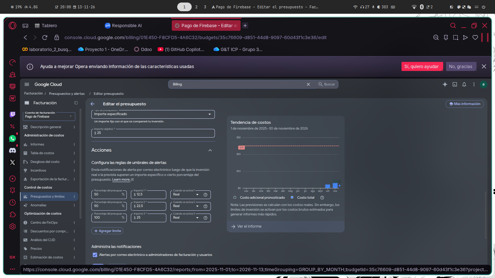
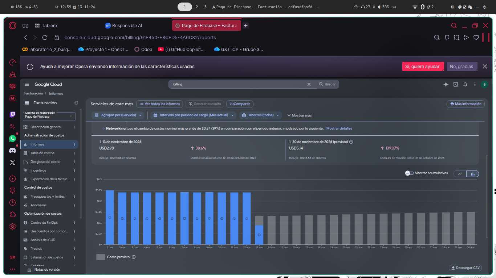
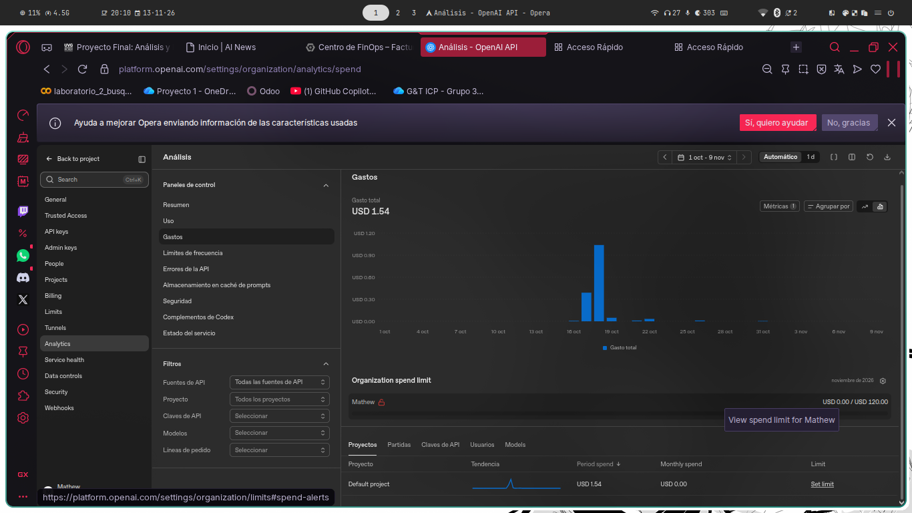
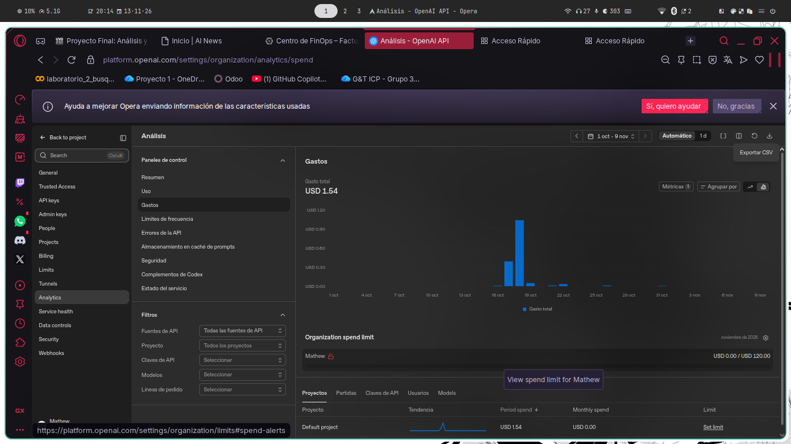
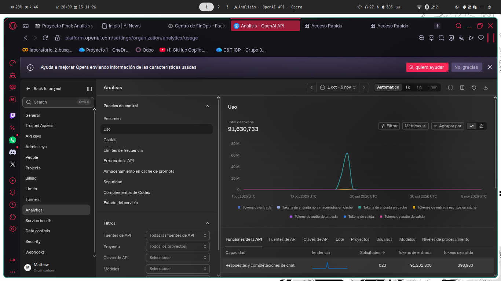
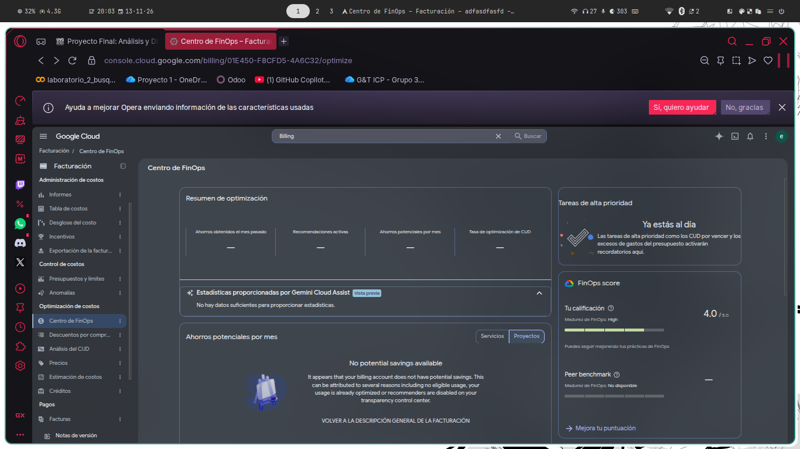

# 7. Gestión financiera FinOps

**Estado:** En proceso. Los controles actuales están implementados y los costos de octubre están documentados; la optimización adicional es un piloto propuesto, todavía sin ahorro medido.

**Moneda y período:** USD, del **1 al 31 de octubre de 2026** para ambos proveedores. Los importes actuales son reales; los propuestos forman un escenario estimado para el mismo volumen de uso.

| Servicio o recurso | Costo actual real | Costo propuesto estimado |
| --- | ---: | ---: |
| Google Cloud, proyecto de la app | USD 2.15 | USD 2.15, sin cambio propuesto |
| API de OpenAI, app de noticias | USD 1.54 | USD 1.39, meta de 10 % menos |
| **Total de estos dos proveedores** | **USD 3.69** | **USD 3.54** |

El total incluye Google Cloud y OpenAI; no incluye facturación separada de MongoDB Atlas ni otros proveedores.

Se evaluó con el CSV de costos de Google Cloud de octubre de 2026, cuyo [resumen sin identificadores de cuenta](evidencias/google-cloud-octubre-2026-resumen.csv) muestra que **Networking costó USD 2.14**; de eso, el uso de IP de Cloud NAT fue USD 2.10. Cloud Run generó USD 0.07 brutos, compensados por créditos, y su costo neto fue **USD 0.00**. El total facturado por Google fue USD 2.15. La captura del panel de Google incluida abajo corresponde al **1–13 de noviembre** y sirve para mostrar la tendencia, no para calcular la tabla de octubre.

Se evaluó con el CSV de costos de OpenAI del 1 al 31 de octubre de 2026. El [resumen diario sin identificadores](evidencias/openai-octubre-2026-resumen.csv) suma **USD 1.541324385**, redondeado a USD 1.54. Para este análisis, el consumo se atribuye únicamente a la aplicación de noticias; el CSV exportado no identifica el proyecto en sus columnas. La captura del panel abarca **1 de octubre–9 de noviembre**; el importe de octubre de la tabla se toma del CSV filtrado al mes completo.

**Medida de ahorro y decisión:** Ya están implementados estos controles: Cloud Run usa **cero instancias mínimas** y un máximo predeterminado de **dos**; Google Cloud tiene un presupuesto de **USD 25** con avisos al **50 %, 90 % y 100 %**; el chatbot tiene un límite predeterminado de **1,600 tokens de salida** por respuesta de OpenAI, usa razonamiento `low`, comprueba el presupuesto funcional acumulado de **USD 20** en `aiUsage` y responde consultas factuales desde MongoDB sin llamada al modelo. El presupuesto de la app es acumulado, no mensual. Las alertas de Google son avisos y [no detienen automáticamente el gasto](https://docs.cloud.google.com/billing/docs/how-to/budgets).

Como optimización adicional, se propone **probar un límite de 1,200 tokens de salida** para el chatbot de noticias. La meta del piloto es reducir **10 %** el gasto mensual de OpenAI con un volumen y tipo de consultas comparables. El costo propuesto de USD 1.39 es **un escenario**, calculado como `1.54 × 0.90`; no representa ahorro ya obtenido. Reducir el límite puede dejar respuestas incompletas, por lo que debe medirse la calidad antes de mantenerlo. [OpenAI recomienda reducir tokens para bajar costos](https://developers.openai.com/api/docs/guides/cost-optimization) y documenta que el límite incluye tokens visibles y de razonamiento [en Responses](https://developers.openai.com/api/reference/resources/responses/methods/create).

**Estado e impacto:** El ahorro del piloto **todavía no se ha medido**. El escenario estima **USD 0.15 para un período comparable a octubre**, aproximadamente **4.1 %** del total de la tabla, bajo el supuesto explícito de un gasto de OpenAI 10 % menor. Google Cloud permanece en USD 2.15 en la estimación. Octubre incluyó solo parte del tiempo de operación de la infraestructura; estos importes no se extrapolan a un mes completo de producción.

## Evaluación objetiva de infraestructura y servicios

| Área | Hallazgo de octubre | Estrategia y decisión |
| --- | --- | --- |
| Cloud NAT e IP de salida | `Networking` concentró USD 2.14 de los USD 2.15 de Google; la IP de NAT aportó USD 2.10. | **Prioridad de revisión: alta.** Mantener la IP fija mientras Atlas dependa de su lista de acceso. Comparar el costo mensual completo de esta conexión con otras opciones admitidas por el clúster antes de cambiar la red; no se atribuye un ahorro aún. |
| Cloud Run | USD 0.07 brutos, compensados por créditos: USD 0.00 netos. | Conservar `min-instances=0` y el máximo actual; reducir capacidad ahora no demuestra ahorro en la factura y podría afectar disponibilidad. Revisar el costo neto en los próximos meses. |
| OpenAI | USD 1.54 atribuidos a la app; el CSV permite verificar el importe, aunque no identifica el proyecto. | Probar el límite de 1,200 tokens y medir gasto por respuesta útil, respuestas incompletas y calidad antes de mantenerlo. |
| Presupuesto de Google | Presupuesto configurado de USD 25 con avisos al 50 %, 90 % y 100 %. | Mantener el aviso como control de seguimiento. Después de un mes completo, revisar si el primer aviso llega suficientemente temprano; ajustar el presupuesto si el gasto normal y el riesgo justifican otro umbral. El aviso no reduce cargos por sí mismo. |

La [IP estática de salida de Cloud Run usa Cloud NAT](https://docs.cloud.google.com/run/docs/configuring/static-outbound-ip); en este proyecto Atlas autoriza esa IP. [Atlas permite conexiones mediante lista de IP o red privada](https://www.mongodb.com/docs/atlas/app-connections/partner-integration-guide/), pero [los endpoints privados pueden añadir cargos horarios](https://www.mongodb.com/docs/atlas/billing/additional-services/). Por ello, la comparación debe incluir costo, compatibilidad del clúster, seguridad y disponibilidad antes de proponer una migración. El reporte del **1–13 de noviembre** muestra USD 2.98 acumulados y USD 5.14 previstos para el mes; es una tendencia parcial y no se mezcla con los costos reales de octubre.

**Indicadores para validar la mejora:** costo estimado por respuesta `llm` útil en `aiUsage`, costo mensual facturado por OpenAI, promedio de `outputTokens`, porcentaje de respuestas incompletas, gasto mensual de Cloud NAT/IP y costo total mensual de Google. Comparar períodos con volumen de consultas semejante y registrar cualquier cambio de calidad o disponibilidad.

**Responsable y fecha:** Mathew Alexander Cordero Aquino — 13 de noviembre de 2026.

## Evidencia

- **Evaluación con el CSV de Google Cloud de octubre:** [resumen sin identificadores de cuenta](evidencias/google-cloud-octubre-2026-resumen.csv), elaborado a partir del CSV exportado de la tabla de costos. El CSV original queda fuera del repositorio por contener identificadores de facturación.
- **Evaluación con el CSV de OpenAI de octubre:** [resumen diario sin identificadores](evidencias/openai-octubre-2026-resumen.csv), derivado del CSV exportado del panel de OpenAI.
- **Presupuesto Google de USD 25 y umbrales 50/90/100 %:**

  

- **Gasto Google del 1–13 de noviembre, mostrado solo como tendencia:**

  

- **Panel de OpenAI y uso de tokens; las capturas muestran un intervalo más amplio que octubre:**

  

  

  

  El límite de USD 120 visible en el panel corresponde a la organización de OpenAI; es distinto del presupuesto funcional de USD 20 configurado en esta app.

- **Centro FinOps de Google al 13 de noviembre:** muestra que no había recomendaciones activas de ahorro en esa vista; no prueba que el gasto sea óptimo.

  

**Controles en código:** [despliegue de Cloud Run](../../../../deploy/gcp/deploy.sh), [parámetros cloud](../../../../deploy/gcp/config.sh), [configuración del chatbot](../../../../backend/assistant/config.py), [proveedor OpenAI](../../../../backend/assistant/providers/openai.py) y [servicio de chat de noticias](../../../../backend/assistant/news_chat/service.py).

```bash
  --min-instances 0
  --max-instances "$MAX_INSTANCES"
```

```python
max_output_tokens=_read_positive_int("OPENAI_MAX_OUTPUT_TOKENS", 1_600),
```

```bash
NEWS_AI_BUDGET_USD="${NEWS_AI_BUDGET_USD:-20}"
```

El [proveedor OpenAI](../../../../backend/assistant/providers/openai.py) envía ese máximo a la API con `reasoning` configurado en `low`; el [servicio de noticias](../../../../backend/assistant/news_chat/service.py) comprueba el presupuesto antes de llamar al modelo.

## Cómo aplicar el piloto propuesto

1. En `deploy/gcp/config.sh`, declarar `OPENAI_MAX_OUTPUT_TOKENS` con valor predeterminado `1600`; en `deploy/gcp/deploy.sh`, pasarlo como variable al servicio `news-chatbot`. En `.github/workflows/deploy.yml`, leerlo de `vars.OPENAI_MAX_OUTPUT_TOKENS`. Añadir o ajustar las pruebas y la documentación de despliegue. **Crear solo la variable en GitHub no basta:** el script actual no la transmite a Cloud Run.
2. En **GitHub → Settings → Environments → production → Environment variables**, definir `OPENAI_MAX_OUTPUT_TOKENS=1200`. Ejecutar `make deploy-test` y las pruebas del chatbot, integrar el cambio de código mediante PR y después ejecutar el despliegue habitual.
3. Probar las mismas preguntas de resumen y explicación antes y después. Comparar `outputTokens`, `estimatedCostUsd`, cantidad de respuestas incompletas y calidad de respuesta. Mantener `1200` solo si cumple la calidad requerida; volver a `1600` si recorta respuestas útiles.
4. Al cerrar un mes comparable, reemplazar el escenario estimado de la tabla por el costo real observado y registrar el ahorro medido.
